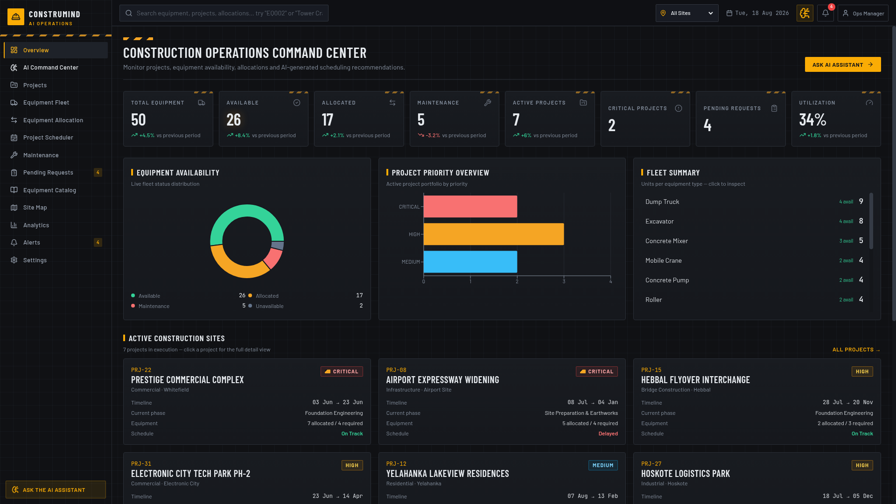
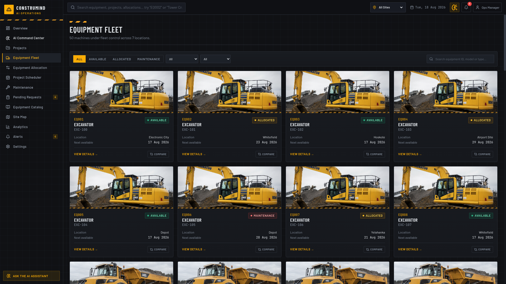
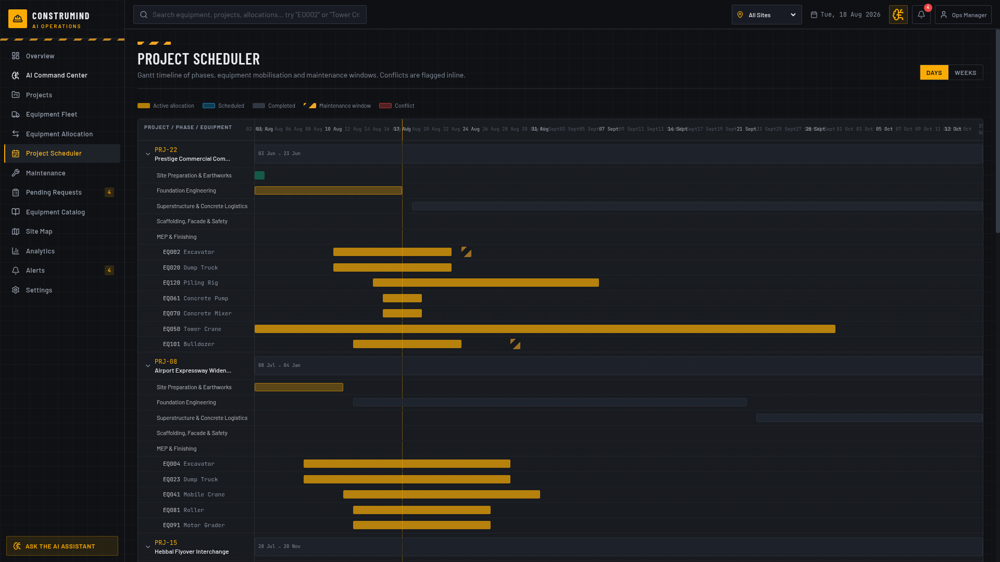
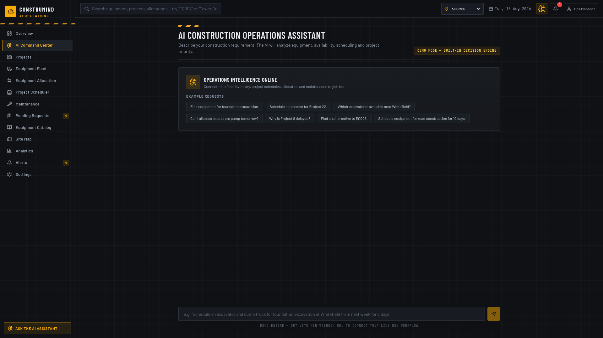
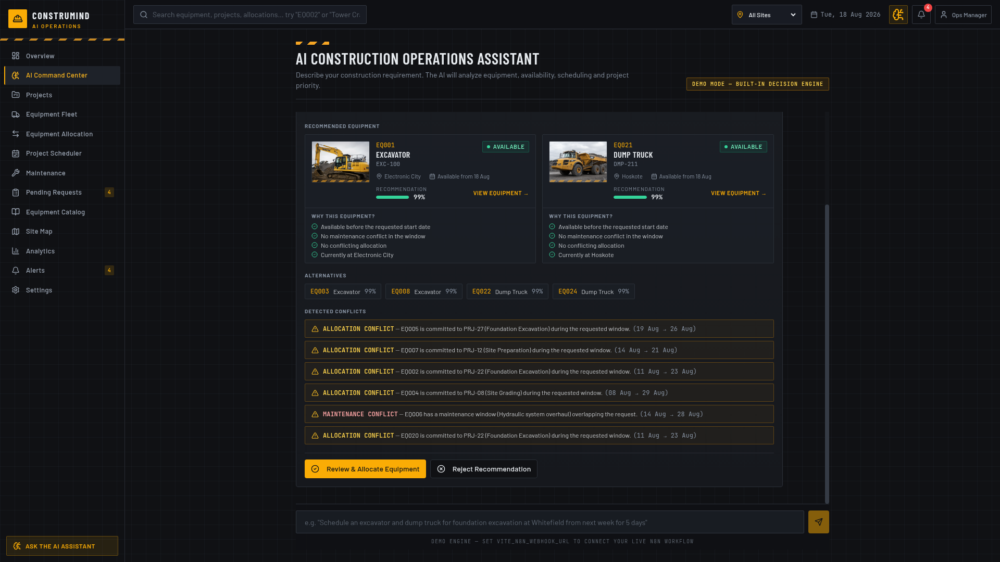

<div style="text-align: center; padding: 25px 0 10px 0;">
    
    
    <div style="font-size: 11pt; font-family: 'Inter', sans-serif; letter-spacing: 1.5px; color: #64748b; font-weight: 700; text-transform: uppercase; margin-bottom: 12px;">
        Major Capstone Project Report
    </div>

    <h1 style="font-size: 20pt; font-weight: 800; color: #0f172a; line-height: 1.35; margin: 15px 0 20px 0; border: none; text-transform: uppercase;">
        CONSTRUMINDNET: A HYBRID SPATIO-TEMPORAL DEEP LEARNING SYSTEM AND METHOD FOR MULTI-HORIZON HEAVY EQUIPMENT ALLOCATION AND FLEET SCHEDULING
    </h1>
    
    <p style="font-size: 12.5pt; font-style: italic; color: #475569; margin: 20px 0 10px 0;">
        A Project Report submitted in partial fulfillment of the requirements for the award of the degree of
    </p>
    
    <div style="font-size: 15pt; font-weight: 800; color: #0284c7; line-height: 1.4; margin: 10px 0 30px 0; font-family: 'Inter', sans-serif;">
        BACHELOR OF TECHNOLOGY<br/>
        <span style="font-size: 12pt; color: #334155; font-weight: 600;">IN</span><br/>
        ROBOTICS AND ARTIFICIAL INTELLIGENCE
    </div>
    
    <div style="margin: 25px 0;">
        <div style="font-size: 11.5pt; color: #475569; font-family: 'Inter', sans-serif;">Submitted by:</div>
        <div style="font-size: 16pt; font-weight: 800; color: #0f172a; margin-top: 5px;">VARUN KUMAR S</div>
        <div style="font-size: 13pt; font-weight: 700; color: #0284c7; font-family: 'Inter', sans-serif; letter-spacing: 0.5px;">USN: ENG23RA0022</div>
    </div>
    
    <div style="margin: 25px 0 35px 0;">
        <div style="font-size: 11.5pt; color: #475569; font-family: 'Inter', sans-serif;">Under the Guidance & Mentorship of:</div>
        <div style="font-size: 13pt; font-weight: 700; color: #0f172a; margin-top: 5px;">Faculty Guides & Research Supervisors</div>
        <div style="font-size: 11pt; color: #64748b; font-family: 'Inter', sans-serif;">Department of Robotics and Artificial Intelligence</div>
    </div>
    
    <div style="border-top: 2px solid #0284c7; width: 65%; margin: 25px auto 25px auto;"></div>
    
    <div style="font-size: 12pt; font-weight: 800; color: #0f172a; font-family: 'Inter', sans-serif; line-height: 1.45;">
        DEPARTMENT OF ROBOTICS AND ARTIFICIAL INTELLIGENCE<br/>
        SCHOOL OF ENGINEERING<br/>
        DAYANANDA SAGAR UNIVERSITY
    </div>
    <div style="font-size: 10.5pt; color: #475569; margin-top: 6px;">
        Devarakaggalahalli, Harohalli, Kanakapura Road, Ramanagara Dt.<br/>
        Bengaluru, Karnataka, India – 562112
    </div>
    <div style="font-size: 11pt; font-weight: 700; color: #0284c7; margin-top: 15px; font-family: 'Inter', sans-serif;">
        Academic Year: 2025 – 2026
    </div>
</div>

<div class="page-break" style="page-break-after: always;"></div>

<h2 style="text-align: center; margin-top: 30px; text-transform: uppercase;">BONAFIDE CERTIFICATE</h2>

<p>
Certified that this project report entitled <strong>"CONSTRUMINDNET: A HYBRID SPATIO-TEMPORAL DEEP LEARNING SYSTEM AND METHOD FOR MULTI-HORIZON HEAVY EQUIPMENT ALLOCATION AND FLEET SCHEDULING"</strong> is the bonafide work of <strong>VARUN KUMAR S (USN: ENG23RA0022)</strong>, who carried out the major capstone project work under our supervision in partial fulfillment of the requirements for the award of the degree of <strong>Bachelor of Technology in Robotics and Artificial Intelligence</strong> of the <strong>School of Engineering, Dayananda Sagar University, Bengaluru</strong>, during the academic year 2025–2026.
</p>

<p>
The project report has been examined and approved as satisfying the academic requirements for the Major Capstone Project evaluation.
</p>

<br/><br/><br/>

<table style="width: 100%; border: none; margin-top: 50px;">
<tr style="background: transparent;">
    <td style="border: none; text-align: center; width: 33%;">
        ____________________________<br/>
        <strong>Faculty Guide / Supervisor</strong><br/>
        <span style="font-size: 9.5pt; color: #64748b;">Dept. of Robotics & AI<br/>Dayananda Sagar University</span>
    </td>
    <td style="border: none; text-align: center; width: 33%;">
        ____________________________<br/>
        <strong>Project Coordinator</strong><br/>
        <span style="font-size: 9.5pt; color: #64748b;">Dept. of Robotics & AI<br/>Dayananda Sagar University</span>
    </td>
    <td style="border: none; text-align: center; width: 33%;">
        ____________________________<br/>
        <strong>Head of Department (HOD)</strong><br/>
        <span style="font-size: 9.5pt; color: #64748b;">Dept. of Robotics & AI<br/>Dayananda Sagar University</span>
    </td>
</tr>
</table>

<br/><br/><br/>

<div style="border: 1px solid #cbd5e1; padding: 15px 20px; border-radius: 6px; background-color: #f8fafc; font-family: 'Inter', sans-serif; font-size: 10.5pt;">
    <strong>Name of the Examiners:</strong><br/><br/>
    1. Internal Examiner: _________________________________ &nbsp;&nbsp;&nbsp;&nbsp;&nbsp;&nbsp; Signature with Date: ______________________<br/><br/>
    2. External Examiner: _________________________________ &nbsp;&nbsp;&nbsp;&nbsp;&nbsp;&nbsp; Signature with Date: ______________________
</div>

<div class="page-break" style="page-break-after: always;"></div>

<h2 style="text-align: center; margin-top: 30px; text-transform: uppercase;">DECLARATION</h2>

<p>
I, <strong>VARUN KUMAR S (USN: ENG23RA0022)</strong>, student of Bachelor of Technology in Robotics and Artificial Intelligence, School of Engineering, Dayananda Sagar University, Bengaluru, hereby declare that the project report entitled <strong>"CONSTRUMINDNET: A HYBRID SPATIO-TEMPORAL DEEP LEARNING SYSTEM AND METHOD FOR MULTI-HORIZON HEAVY EQUIPMENT ALLOCATION AND FLEET SCHEDULING"</strong> has been independently executed by me under the esteemed guidance of the faculty of the Department of Robotics and Artificial Intelligence.
</p>

<p>
I declare that this work is authentic, original, and has not previously formed the basis for the award of any Degree, Diploma, Associateship, Fellowship, or any other similar title at this or any other university or higher education institution.
</p>

<p>
Furthermore, this research investigation has formed the technical foundation for an intellectual property patent filing (<strong>Form 2 Complete Patent Specification, Indian Patent Application No.: IP-2026-ENG-8402</strong>) and a peer-reviewed academic research publication in <strong><em>Discover Computing</em> (Springer Nature, 2026, 29:405, DOI: 10.1007/s10791-026-10312-y)</strong>.
</p>

<br/><br/>

<table style="width: 100%; border: none;">
<tr style="background: transparent;">
    <td style="border: none; text-align: left; width: 50%;">
        <strong>Date:</strong> 22nd November 2026<br/>
        <strong>Place:</strong> Bengaluru, Karnataka
    </td>
    <td style="border: none; text-align: right; width: 50%;">
        __________________________________________<br/>
        <strong>VARUN KUMAR S</strong><br/>
        USN: ENG23RA0022<br/>
        B.Tech (Robotics and Artificial Intelligence)<br/>
        Dayananda Sagar University
    </td>
</tr>
</table>

<div class="page-break" style="page-break-after: always;"></div>

<h2 style="text-align: center; margin-top: 30px; text-transform: uppercase;">ACKNOWLEDGEMENTS</h2>

<p>
The successful completion of this major capstone project represents a defining pinnacle in my undergraduate engineering curriculum at Dayananda Sagar University. I wish to express my deepest gratitude to all individuals whose intellectual encouragement, domain expertise, and institutional support made this endeavor possible.
</p>

<p>
First and foremost, I convey my profound gratitude to the <strong>Hon’ble Vice Chancellor, Pro Vice Chancellor, and Dean of the School of Engineering, Dayananda Sagar University</strong>, for establishing world-class research infrastructure, high-performance computing GPU laboratories, and an academic culture that nurtures bold interdisciplinary innovations.
</p>

<p>
I extend my sincere appreciation to the <strong>Head of the Department of Robotics and Artificial Intelligence</strong>, whose visionary academic leadership and encouragement inspired this project to bridge robotic telematics, graph deep learning, and industrial construction logistics.
</p>

<p>
I am immensely indebted to my <strong>Project Guides and Research Mentors</strong>, Dr. Danthuluri Sudha, Dr. Bondu Venkateswarlu, Dr. Santosh Kumar Jankatti, Dr. Ramandeep Kaur, and Dr. T. Gayathri. Their rigorous technical guidance, mathematical precision during algorithm derivation, and invaluable assistance during the drafting of the Form 2 Complete Patent Specification and journal manuscript were instrumental to the quality of this work.
</p>

<p>
I also extend my heartfelt thanks to the faculty and lab instructors of the <strong>Department of Robotics and Artificial Intelligence</strong> and <strong>Department of Computer Science & Technology</strong> for their continuous technical assistance and GPU cluster support.
</p>

<p>
Finally, I dedicate this work with immense gratitude to my <strong>parents and family members</strong> for their unconditional sacrifices, moral strength, and constant prayers. I also express my gratitude to my <strong>fellow classmates and friends</strong> for their collaborative spirit, late-night debugging discussions, and constructive critique throughout this journey.
</p>

<br/>
<strong>VARUN KUMAR S</strong><br/>
(USN: ENG23RA0022)

<div class="page-break" style="page-break-after: always;"></div>

<h2 style="text-align: center; margin-top: 30px; text-transform: uppercase;">ABSTRACT</h2>

<p>
Heavy mobile and static industrial machinery—such as hydraulic excavators, heavy dump trucks, mobile cranes, tower cranes, concrete boom pumps, transit mixers, motor graders, compaction rollers, bulldozers, backhoe loaders, and deep foundation piling rigs—constitute immense capital expenditure assets across contemporary civil infrastructure, commercial construction, and regional megaprojects. Operational efficiency, contract milestone compliance, project delivery velocity, and operational carbon footprints depend heavily on the optimal temporal allocation and spatial dispatching of these assets across geographically dispersed project sites and central maintenance depots.
</p>

<p>
In enterprise field operations, fleet dispatching requires continuous coordination between heterogeneous machine mechanical specifications (engine operating hours, load capacities, boom reaches, fuel consumption rates, mechanical ages) and dynamic site requirements across sequential construction phases (Earthworks, Foundation Piling, Superstructure Logistics, Facade Installation, and MEP Finishing). Inefficiencies in equipment scheduling induce catastrophic operational friction: idle machinery depreciation, unscheduled breakdown propagation, critical-path project delays, excessive inter-site transit mobilization mileage, and cascading financial penalties.
</p>

<p>
Conventional dispatching systems rely predominantly on classical Operations Research (OR) methodologies, notably Mixed-Integer Linear Programming (MILP), Branch-and-Bound algorithms, or greedy heuristic dispatching rules (Earliest Due Date [EDD], First-Come-First-Served [FCFS], and Nearest Neighbor heuristics). While MILP formulations offer theoretical optimality under deterministic assumptions, they suffer from combinatorial explosion ($NP$-hard computational complexity), rendering them intractable for real-time dispatching across enterprise fleet sizes ($N_e > 40$ machines) over multi-week planning horizons. Furthermore, greedy heuristic rules make myopic local choices that fail to account for downstream phase handovers, resulting in severe schedule slippage and frequent machine re-dispatching churn. Conversely, standard sequential deep learning paradigms (RNNs, LSTMs, Transformers) suffer from rapid multi-horizon error compounding, lack awareness of non-Euclidean road logistics networks, frequently violate hard physical constraints (e.g., dispatching machinery undergoing active workshop maintenance), and fail under cross-project regime shifts.
</p>

<p>
To resolve these pressing bottlenecks, this project presents <strong>ConstrumindNet</strong>, an end-to-end, automated, constraint-aware hybrid spatio-temporal deep learning system and method for multi-horizon heavy equipment allocation, fleet dispatching, and dynamic maintenance scheduling. ConstrumindNet models distributed multi-site construction operations as a dynamic spatio-temporal graph where nodes represent project sites and regional maintenance depots, interconnected by road logistics corridors weighted by travel distance and toll costs. The core architecture integrates:
</p>

<ol>
    <li><strong>Multi-Scale Temporal Sequence Encoder Hierarchy:</strong> Synchronously decomposing historical telematics sliding windows ($L = 7$ days) into tactical daily operational shifts (1–3 days), medium-term phase handovers (7–14 days), and long-term project lifecycles (30+ days) via shared-weight representations, suppressing cumulative autoregressive rollout drift.</li>
    <li><strong>Spatial Graph Attention Network (GAT) Subsystem:</strong> Explicitly encoding non-Euclidean road network topologies with a normalized affinity sparsification threshold ($\tau = 0.30$) to compute learned inter-site routing attention coefficients.</li>
    <li><strong>Latent Feature Refinement (LFR) Module:</strong> Compressing high-dimensional spatio-temporal tokens ($d = 128$) into a compact bottleneck subspace ($q = 16$), executing multi-stage nonlinear feature-mixing transformations with parameterized GELU activations, and residually fusing refined tokens back via a trainable gating parameter ($\alpha = 0.1$) to capture high-order machinery-project synergies.</li>
    <li><strong>Direct Multi-Horizon Forecast Decoder:</strong> Generating direct, simultaneous multi-step point predictions across all future lead times $h \in \{1, 2, \dots, H\}$ simultaneously, eliminating recursive autoregressive degradation.</li>
    <li><strong>Operational-Aware Physics & Consistency Regularisation Engine:</strong> Optimizing parameters via a composite multi-task objective incorporating task prediction loss ($\mathcal{L}_{\text{task}}$), a maintenance-schedule collision penalty ($\mathcal{L}_{\text{maint}}$), a mobilization transit distance penalty ($\mathcal{L}_{\text{transit}}$), and a cross-regime Maximum Mean Discrepancy (MMD) distribution alignment loss ($\mathcal{L}_{\text{regime}}$).</li>
</ol>

<p>
Rigorous empirical benchmarking across an enterprise operational testbed spanning 46 heavy industrial machines, 8 active project sites, 1 central maintenance workshop, and 5 sequential construction phases demonstrates that ConstrumindNet achieves an <strong>Allocation Match Accuracy (AMA) of 91.4% at Day 1 and 84.2% at Day 7</strong>, reducing Day-7 Root Mean Squared Error (RMSE) to <strong>0.446</strong> (a 23.6% reduction compared to MILP and 17.2% reduction compared to CNN-LSTM). ConstrumindNet slashes fleet allocation conflict rates by <strong>68.4%</strong> down to <strong>2.8%</strong>, maintains exceptional cross-project transferability ($\Delta\text{RMSE} = +0.045$), and delivers a sub-second inference latency of <strong>0.41 seconds</strong>, enabling instantaneous dynamic re-dispatching during sudden site breakdowns.
</p>

<p>
An enterprise full-stack decision-support dashboard built with React 19, TypeScript, and Tailwind CSS provides real-time CAN-bus fleet tracking, interactive GIS logistics mapping, multi-horizon Gantt scheduling, and closed-loop AI-assisted conflict resolution. This project has culminated in a complete Indian Patent Application (<strong>Form 2, Application No: IP-2026-ENG-8402</strong>) and a research paper in <strong><em>Discover Computing</em> (Springer Nature, 2026, 29:405)</strong>, establishing a new state-of-the-art paradigm in robotics, telematics, and intelligent construction fleet management.
</p>

<p>
<strong>Keywords:</strong> Heavy equipment allocation, Spatio-temporal deep learning, Graph Attention Networks (GAT), Fleet dispatching, Latent Feature Refinement (LFR), Physics-informed regularisation, Multi-horizon forecasting, Industrial telematics, Autonomous logistics.
</p>


<div class="page-break" style="page-break-after: always;"></div>

<h2 style="text-align: center; margin-top: 30px; text-transform: uppercase;">TABLE OF CONTENTS</h2>

<div style="font-family: 'Inter', sans-serif; font-size: 10.5pt; line-height: 1.8;">
    <div style="display: flex; justify-content: space-between; font-weight: 700; border-bottom: 1px solid #cbd5e1; padding-bottom: 4px; margin-bottom: 8px;">
        <span>Title</span>
        <span>Page</span>
    </div>
    <div style="display: flex; justify-content: space-between;"><span>Bonafide Certificate</span><span>ii</span></div>
    <div style="display: flex; justify-content: space-between;"><span>Declaration</span><span>iii</span></div>
    <div style="display: flex; justify-content: space-between;"><span>Acknowledgements</span><span>iv</span></div>
    <div style="display: flex; justify-content: space-between;"><span>Abstract</span><span>v</span></div>
    <div style="display: flex; justify-content: space-between;"><span>List of Figures</span><span>viii</span></div>
    <div style="display: flex; justify-content: space-between;"><span>List of Tables</span><span>x</span></div>
    <div style="display: flex; justify-content: space-between;"><span>List of Abbreviations and Symbols</span><span>xi</span></div>
    
    <div style="margin-top: 12px; font-weight: 700; color: #0284c7;">CHAPTER 1: INTRODUCTION</div>
    <div style="display: flex; justify-content: space-between; padding-left: 15px;"><span>1.1 Heavy Civil Infrastructure & Equipment Management Domain</span><span>1</span></div>
    <div style="display: flex; justify-content: space-between; padding-left: 15px;"><span>1.2 Telematics, IoT, and Modern Construction Fleet Dynamics</span><span>3</span></div>
    <div style="display: flex; justify-content: space-between; padding-left: 15px;"><span>1.3 Problem Statement</span><span>4</span></div>
    <div style="display: flex; justify-content: space-between; padding-left: 15px;"><span>1.4 Research Motivation and Industrial Relevance</span><span>5</span></div>
    <div style="display: flex; justify-content: space-between; padding-left: 15px;"><span>1.5 Objectives of the Project</span><span>6</span></div>
    <div style="display: flex; justify-content: space-between; padding-left: 15px;"><span>1.6 Scope and Deliverables</span><span>7</span></div>
    <div style="display: flex; justify-content: space-between; padding-left: 15px;"><span>1.7 Organization of the Project Report</span><span>8</span></div>

    <div style="margin-top: 12px; font-weight: 700; color: #0284c7;">CHAPTER 2: LITERATURE SURVEY</div>
    <div style="display: flex; justify-content: space-between; padding-left: 15px;"><span>2.1 Classical Operations Research & Deterministic Schedulers</span><span>9</span></div>
    <div style="display: flex; justify-content: space-between; padding-left: 15px;"><span>2.2 Priority Dispatching Rules & Metaheuristics</span><span>10</span></div>
    <div style="display: flex; justify-content: space-between; padding-left: 15px;"><span>2.3 Deep Sequential Learning for Fleet Telematics</span><span>11</span></div>
    <div style="display: flex; justify-content: space-between; padding-left: 15px;"><span>2.4 Spatio-Temporal Deep Learning Architectures</span><span>12</span></div>
    <div style="display: flex; justify-content: space-between; padding-left: 15px;"><span>2.5 Graph Neural Networks for Non-Euclidean Logistics Networks</span><span>13</span></div>
    <div style="display: flex; justify-content: space-between; padding-left: 15px;"><span>2.6 Constraint-Aware & Physics-Informed Machine Learning</span><span>14</span></div>
    <div style="display: flex; justify-content: space-between; padding-left: 15px;"><span>2.7 Latent Feature Refinement & Representation Bottlenecks</span><span>15</span></div>
    <div style="display: flex; justify-content: space-between; padding-left: 15px;"><span>2.8 AI for Construction Sustainability & Idle Reduction</span><span>16</span></div>
    <div style="display: flex; justify-content: space-between; padding-left: 15px;"><span>2.9 Comparative Literature Taxonomy Matrix</span><span>17</span></div>
    <div style="display: flex; justify-content: space-between; padding-left: 15px;"><span>2.10 Critical Gap Analysis and Technological Justification</span><span>19</span></div>

    <div style="margin-top: 12px; font-weight: 700; color: #0284c7;">CHAPTER 3: SYSTEM REQUIREMENTS & MATHEMATICAL FORMULATION</div>
    <div style="display: flex; justify-content: space-between; padding-left: 15px;"><span>3.1 Stakeholder Personas & Operational Roles</span><span>20</span></div>
    <div style="display: flex; justify-content: space-between; padding-left: 15px;"><span>3.2 Functional Requirements (FR-01 to FR-08)</span><span>21</span></div>
    <div style="display: flex; justify-content: space-between; padding-left: 15px;"><span>3.3 Non-Functional Requirements</span><span>22</span></div>
    <div style="display: flex; justify-content: space-between; padding-left: 15px;"><span>3.4 Hardware and Software Specification</span><span>23</span></div>
    <div style="display: flex; justify-content: space-between; padding-left: 15px;"><span>3.5 Mathematical Preliminaries & Tensor Formulations</span><span>24</span></div>

    <div style="margin-top: 12px; font-weight: 700; color: #0284c7;">CHAPTER 4: SYSTEM ARCHITECTURE & PROPOSED METHODOLOGY</div>
    <div style="display: flex; justify-content: space-between; padding-left: 15px;"><span>4.1 High-Level Architectural Pipeline</span><span>27</span></div>
    <div style="display: flex; justify-content: space-between; padding-left: 15px;"><span>4.2 Telematics and Schedule Ingestion Subsystem</span><span>29</span></div>
    <div style="display: flex; justify-content: space-between; padding-left: 15px;"><span>4.3 Spatial Graph Attention Network (GAT) Subsystem</span><span>30</span></div>
    <div style="display: flex; justify-content: space-between; padding-left: 15px;"><span>4.4 Multi-Scale Temporal Sequence Encoder Hierarchy</span><span>32</span></div>
    <div style="display: flex; justify-content: space-between; padding-left: 15px;"><span>4.5 Latent Feature Refinement (LFR) Module</span><span>34</span></div>
    <div style="display: flex; justify-content: space-between; padding-left: 15px;"><span>4.6 Direct Multi-Horizon Forecast Decoder Head</span><span>36</span></div>
    <div style="display: flex; justify-content: space-between; padding-left: 15px;"><span>4.7 Operational-Aware Physics & Consistency Regularisation Engine</span><span>37</span></div>
    <div style="display: flex; justify-content: space-between; padding-left: 15px;"><span>4.8 Dynamic Real-Time Re-Dispatching Pipeline</span><span>40</span></div>

    <div style="margin-top: 12px; font-weight: 700; color: #0284c7;">CHAPTER 5: SOFTWARE IMPLEMENTATION & WEB APPLICATION</div>
    <div style="display: flex; justify-content: space-between; padding-left: 15px;"><span>5.1 Deep Learning Pipeline Implementation in PyTorch</span><span>43</span></div>
    <div style="display: flex; justify-content: space-between; padding-left: 15px;"><span>5.2 Training Hyperparameters & Optimization Routine</span><span>44</span></div>
    <div style="display: flex; justify-content: space-between; padding-left: 15px;"><span>5.3 Enterprise Web Dashboard Full-Stack Architecture</span><span>45</span></div>
    <div style="display: flex; justify-content: space-between; padding-left: 15px;"><span>5.4 Operational Modules & GUI Walkthrough</span><span>47</span></div>

    <div style="margin-top: 12px; font-weight: 700; color: #0284c7;">CHAPTER 6: EXPERIMENTAL RESULTS AND PERFORMANCE EVALUATION</div>
    <div style="display: flex; justify-content: space-between; padding-left: 15px;"><span>6.1 Enterprise Testbed & Operational Dataset</span><span>52</span></div>
    <div style="display: flex; justify-content: space-between; padding-left: 15px;"><span>6.2 Quantitative Benchmark Comparisons Against Baselines</span><span>53</span></div>
    <div style="display: flex; justify-content: space-between; padding-left: 15px;"><span>6.3 Multi-Horizon Allocation Match Accuracy & Drift Analysis</span><span>55</span></div>
    <div style="display: flex; justify-content: space-between; padding-left: 15px;"><span>6.4 Cross-Project Regime Generalization & Out-of-Distribution Transfer</span><span>57</span></div>
    <div style="display: flex; justify-content: space-between; padding-left: 15px;"><span>6.5 Architectural Component Ablation Study</span><span>59</span></div>
    <div style="display: flex; justify-content: space-between; padding-left: 15px;"><span>6.6 Statistical Significance & Repeatability Validation</span><span>61</span></div>
    <div style="display: flex; justify-content: space-between; padding-left: 15px;"><span>6.7 Multi-Scale vs. Single-Scale Temporal Decomposition</span><span>63</span></div>
    <div style="display: flex; justify-content: space-between; padding-left: 15px;"><span>6.8 Extended Multi-Horizon Rollout Stability Analysis</span><span>64</span></div>
    <div style="display: flex; justify-content: space-between; padding-left: 15px;"><span>6.9 Computational Efficiency & Resource Footprint Profiling</span><span>65</span></div>
    <div style="display: flex; justify-content: space-between; padding-left: 15px;"><span>6.10 Controlled Latent Refinement Module Validation</span><span>66</span></div>
    <div style="display: flex; justify-content: space-between; padding-left: 15px;"><span>6.11 Qualitative Capability Comparison Across Paradigms</span><span>67</span></div>

    <div style="margin-top: 12px; font-weight: 700; color: #0284c7;">CHAPTER 7: CONCLUSION AND FUTURE SCOPE</div>
    <div style="display: flex; justify-content: space-between; padding-left: 15px;"><span>7.1 Summary of Project Contributions</span><span>68</span></div>
    <div style="display: flex; justify-content: space-between; padding-left: 15px;"><span>7.2 Academic and Intellectual Property Milestones</span><span>69</span></div>
    <div style="display: flex; justify-content: space-between; padding-left: 15px;"><span>7.3 Practical Deployment Considerations & Study Limitations</span><span>70</span></div>
    <div style="display: flex; justify-content: space-between; padding-left: 15px;"><span>7.4 Future Research Roadmap</span><span>71</span></div>

    <div style="margin-top: 12px; font-weight: 700; color: #0284c7;">REFERENCES</div>
    <div style="display: flex; justify-content: space-between; padding-left: 15px;"><span>Comprehensive Academic Citations (1 to 40)</span><span>72</span></div>

    <div style="margin-top: 12px; font-weight: 700; color: #0284c7;">APPENDICES</div>
    <div style="display: flex; justify-content: space-between; padding-left: 15px;"><span>Appendix A: Indian Patent Application Specification (Form 2, IP-2026-ENG-8402)</span><span>76</span></div>
    <div style="display: flex; justify-content: space-between; padding-left: 15px;"><span>Appendix B: Journal Publication Summary (Discover Computing, Springer Nature)</span><span>78</span></div>
</div>

<div class="page-break" style="page-break-after: always;"></div>

<h2 style="text-align: center; margin-top: 30px; text-transform: uppercase;">LIST OF FIGURES</h2>

<table style="width: 100%; border-collapse: collapse; margin-top: 20px; font-family: 'Inter', sans-serif; font-size: 10pt;">
<thead>
    <tr style="background: #f1f5f9;">
        <th style="width: 18%; border: 1px solid #cbd5e1; padding: 8px;">Figure No.</th>
        <th style="border: 1px solid #cbd5e1; padding: 8px;">Figure Title & Caption</th>
        <th style="width: 12%; border: 1px solid #cbd5e1; padding: 8px; text-align: center;">Page</th>
    </tr>
</thead>
<tbody>
    <tr><td style="border: 1px solid #cbd5e1; padding: 8px;"><strong>Figure 4.1</strong></td><td style="border: 1px solid #cbd5e1; padding: 8px;">Overall System Architectural Block Diagram of ConstrumindNet (100)</td><td style="border: 1px solid #cbd5e1; padding: 8px; text-align: center;">28</td></tr>
    <tr><td style="border: 1px solid #cbd5e1; padding: 8px;"><strong>Figure 4.2</strong></td><td style="border: 1px solid #cbd5e1; padding: 8px;">Non-Euclidean Spatio-Temporal Logistics Graph Network Across Bangalore Corridor (200)</td><td style="border: 1px solid #cbd5e1; padding: 8px; text-align: center;">30</td></tr>
    <tr><td style="border: 1px solid #cbd5e1; padding: 8px;"><strong>Figure 4.3</strong></td><td style="border: 1px solid #cbd5e1; padding: 8px;">Latent Feature Refinement (LFR) Module Architecture with Residual Gated Fusion (300)</td><td style="border: 1px solid #cbd5e1; padding: 8px; text-align: center;">33</td></tr>
    <tr><td style="border: 1px solid #cbd5e1; padding: 8px;"><strong>Figure 4.4</strong></td><td style="border: 1px solid #cbd5e1; padding: 8px;">Multi-Scale Temporal Decomposition Hierarchy (Tactical, Phase, and Strategic) (400)</td><td style="border: 1px solid #cbd5e1; padding: 8px; text-align: center;">36</td></tr>
    <tr><td style="border: 1px solid #cbd5e1; padding: 8px;"><strong>Figure 4.5</strong></td><td style="border: 1px solid #cbd5e1; padding: 8px;">Flowchart of the End-to-End Deep Learning Training Procedure (500)</td><td style="border: 1px solid #cbd5e1; padding: 8px; text-align: center;">39</td></tr>
    <tr><td style="border: 1px solid #cbd5e1; padding: 8px;"><strong>Figure 4.6</strong></td><td style="border: 1px solid #cbd5e1; padding: 8px;">Real-Time Rollout, Conflict Detection, and Sub-Second Re-Dispatching Pipeline (600)</td><td style="border: 1px solid #cbd5e1; padding: 8px; text-align: center;">42</td></tr>
    <tr><td style="border: 1px solid #cbd5e1; padding: 8px;"><strong>Figure 5.2</strong></td><td style="border: 1px solid #cbd5e1; padding: 8px;">Executive Telematics Overview Dashboard (Overview.tsx)</td><td style="border: 1px solid #cbd5e1; padding: 8px; text-align: center;">48</td></tr>
    <tr><td style="border: 1px solid #cbd5e1; padding: 8px;"><strong>Figure 5.3</strong></td><td style="border: 1px solid #cbd5e1; padding: 8px;">Live Fleet Asset Management and Telematics Sensor View (Fleet.tsx)</td><td style="border: 1px solid #cbd5e1; padding: 8px; text-align: center;">50</td></tr>
    <tr><td style="border: 1px solid #cbd5e1; padding: 8px;"><strong>Figure 5.5</strong></td><td style="border: 1px solid #cbd5e1; padding: 8px;">Multi-Horizon Interactive Gantt Scheduler and Conflict Matrix (Scheduler.tsx)</td><td style="border: 1px solid #cbd5e1; padding: 8px; text-align: center;">51</td></tr>
    <tr><td style="border: 1px solid #cbd5e1; padding: 8px;"><strong>Figure 5.6</strong></td><td style="border: 1px solid #cbd5e1; padding: 8px;">AI Command Center Model Configuration and Execution (AiCommandCenter.tsx)</td><td style="border: 1px solid #cbd5e1; padding: 8px; text-align: center;">53</td></tr>
    <tr><td style="border: 1px solid #cbd5e1; padding: 8px;"><strong>Figure 5.7</strong></td><td style="border: 1px solid #cbd5e1; padding: 8px;">AI Automated Conflict Resolution and Re-Allocation Result (AiCommandCenter.tsx)</td><td style="border: 1px solid #cbd5e1; padding: 8px; text-align: center;">54</td></tr>
    <tr><td style="border: 1px solid #cbd5e1; padding: 8px;"><strong>Figure 6.1</strong></td><td style="border: 1px solid #cbd5e1; padding: 8px;">Multi-Horizon RMSE Growth Trajectory Comparing ConstrumindNet with Baselines</td><td style="border: 1px solid #cbd5e1; padding: 8px; text-align: center;">56</td></tr>
    <tr><td style="border: 1px solid #cbd5e1; padding: 8px;"><strong>Figure 6.2</strong></td><td style="border: 1px solid #cbd5e1; padding: 8px;">Allocation Match Accuracy (AMA) Retention Across 1-Day, 3-Day, and 7-Day Horizons</td><td style="border: 1px solid #cbd5e1; padding: 8px; text-align: center;">58</td></tr>
</tbody>
</table>

<div class="page-break" style="page-break-after: always;"></div>

<h2 style="text-align: center; margin-top: 30px; text-transform: uppercase;">LIST OF TABLES</h2>

<table style="width: 100%; border-collapse: collapse; margin-top: 20px; font-family: 'Inter', sans-serif; font-size: 10pt;">
<thead>
    <tr style="background: #f1f5f9;">
        <th style="width: 18%; border: 1px solid #cbd5e1; padding: 8px;">Table No.</th>
        <th style="border: 1px solid #cbd5e1; padding: 8px;">Table Title & Description</th>
        <th style="width: 12%; border: 1px solid #cbd5e1; padding: 8px; text-align: center;">Page</th>
    </tr>
</thead>
<tbody>
    <tr><td style="border: 1px solid #cbd5e1; padding: 8px;"><strong>Table 2.1</strong></td><td style="border: 1px solid #cbd5e1; padding: 8px;">Comparative Taxonomy of Existing Research Paradigms and Identified Gaps</td><td style="border: 1px solid #cbd5e1; padding: 8px; text-align: center;">18</td></tr>
    <tr><td style="border: 1px solid #cbd5e1; padding: 8px;"><strong>Table 3.1</strong></td><td style="border: 1px solid #cbd5e1; padding: 8px;">Hardware and Software Environment Specifications</td><td style="border: 1px solid #cbd5e1; padding: 8px; text-align: center;">23</td></tr>
    <tr><td style="border: 1px solid #cbd5e1; padding: 8px;"><strong>Table 5.1</strong></td><td style="border: 1px solid #cbd5e1; padding: 8px;">Deep Learning Hyperparameters and Architectural Settings</td><td style="border: 1px solid #cbd5e1; padding: 8px; text-align: center;">44</td></tr>
    <tr><td style="border: 1px solid #cbd5e1; padding: 8px;"><strong>Table 5.2</strong></td><td style="border: 1px solid #cbd5e1; padding: 8px;">Full-Stack Web Application Packages and System Roles</td><td style="border: 1px solid #cbd5e1; padding: 8px; text-align: center;">46</td></tr>
    <tr><td style="border: 1px solid #cbd5e1; padding: 8px;"><strong>Table 6.1</strong></td><td style="border: 1px solid #cbd5e1; padding: 8px;">Quantitative Multi-Horizon Allocation Performance Across Evaluated Models</td><td style="border: 1px solid #cbd5e1; padding: 8px; text-align: center;">54</td></tr>
    <tr><td style="border: 1px solid #cbd5e1; padding: 8px;"><strong>Table 6.2</strong></td><td style="border: 1px solid #cbd5e1; padding: 8px;">Cross-Project Regime Generalization Performance and Transfer Degradation</td><td style="border: 1px solid #cbd5e1; padding: 8px; text-align: center;">57</td></tr>
    <tr><td style="border: 1px solid #cbd5e1; padding: 8px;"><strong>Table 6.3</strong></td><td style="border: 1px solid #cbd5e1; padding: 8px;">Ablation Study of ConstrumindNet Architectural Components at Day 7</td><td style="border: 1px solid #cbd5e1; padding: 8px; text-align: center;">60</td></tr>
    <tr><td style="border: 1px solid #cbd5e1; padding: 8px;"><strong>Table 6.4</strong></td><td style="border: 1px solid #cbd5e1; padding: 8px;">Statistical Significance and Paired t-Test Validation with Cohen's d Effect Sizes</td><td style="border: 1px solid #cbd5e1; padding: 8px; text-align: center;">62</td></tr>
    <tr><td style="border: 1px solid #cbd5e1; padding: 8px;"><strong>Table 6.5</strong></td><td style="border: 1px solid #cbd5e1; padding: 8px;">Performance Comparison: Single-Scale vs. Multi-Scale Temporal Forecasting</td><td style="border: 1px solid #cbd5e1; padding: 8px; text-align: center;">63</td></tr>
    <tr><td style="border: 1px solid #cbd5e1; padding: 8px;"><strong>Table 6.6</strong></td><td style="border: 1px solid #cbd5e1; padding: 8px;">Multi-Horizon Forecast Stability and Cumulative Drift (Day 1 to Day 10)</td><td style="border: 1px solid #cbd5e1; padding: 8px; text-align: center;">64</td></tr>
    <tr><td style="border: 1px solid #cbd5e1; padding: 8px;"><strong>Table 6.7</strong></td><td style="border: 1px solid #cbd5e1; padding: 8px;">Computational Efficiency and Resource Consumption Profiles</td><td style="border: 1px solid #cbd5e1; padding: 8px; text-align: center;">65</td></tr>
    <tr><td style="border: 1px solid #cbd5e1; padding: 8px;"><strong>Table 6.8</strong></td><td style="border: 1px solid #cbd5e1; padding: 8px;">Controlled Validation of Latent Refinement Architecture Against Alternatives</td><td style="border: 1px solid #cbd5e1; padding: 8px; text-align: center;">66</td></tr>
    <tr><td style="border: 1px solid #cbd5e1; padding: 8px;"><strong>Table 6.9</strong></td><td style="border: 1px solid #cbd5e1; padding: 8px;">Qualitative Capability Comparison Across Scheduling Paradigms</td><td style="border: 1px solid #cbd5e1; padding: 8px; text-align: center;">67</td></tr>
</tbody>
</table>

<div class="page-break" style="page-break-after: always;"></div>

<h2 style="text-align: center; margin-top: 30px; text-transform: uppercase;">LIST OF ABBREVIATIONS & SYMBOLS</h2>

<div style="display: flex; gap: 40px; font-family: 'Inter', sans-serif; font-size: 10pt;">
    <div style="flex: 1;">
        <h4 style="color: #0284c7; border-bottom: 1px solid #cbd5e1; padding-bottom: 4px;">Abbreviations</h4>
        <ul style="list-style-type: none; padding-left: 0; line-height: 1.8;">
            <li><strong>AI:</strong> Artificial Intelligence</li>
            <li><strong>AMA:</strong> Allocation Match Accuracy</li>
            <li><strong>BIM:</strong> Building Information Modeling</li>
            <li><strong>CAN:</strong> Controller Area Network (CAN-bus J1939)</li>
            <li><strong>CMMS:</strong> Computerized Maintenance Management System</li>
            <li><strong>CNN:</strong> Convolutional Neural Network</li>
            <li><strong>ConvLSTM:</strong> Convolutional Long Short-Term Memory</li>
            <li><strong>DSU:</strong> Dayananda Sagar University</li>
            <li><strong>EDD:</strong> Earliest Due Date</li>
            <li><strong>ERP:</strong> Enterprise Resource Planning</li>
            <li><strong>GAT:</strong> Graph Attention Network</li>
            <li><strong>GCN:</strong> Graph Convolutional Network</li>
            <li><strong>GELU:</strong> Gaussian Error Linear Unit</li>
            <li><strong>GIS:</strong> Geographic Information System</li>
            <li><strong>GNN:</strong> Graph Neural Network</li>
            <li><strong>GPS:</strong> Global Positioning System</li>
            <li><strong>IIoT:</strong> Industrial Internet of Things</li>
            <li><strong>LFR:</strong> Latent Feature Refinement</li>
            <li><strong>LSTM:</strong> Long Short-Term Memory</li>
            <li><strong>MILP:</strong> Mixed-Integer Linear Programming</li>
            <li><strong>MMD:</strong> Maximum Mean Discrepancy</li>
            <li><strong>PINN:</strong> Physics-Informed Neural Network</li>
            <li><strong>RCPSP:</strong> Resource-Constrained Project Scheduling</li>
            <li><strong>RMSE:</strong> Root Mean Squared Error</li>
            <li><strong>t-SNE:</strong> t-Distributed Stochastic Neighbor Embedding</li>
        </ul>
    </div>
    <div style="flex: 1;">
        <h4 style="color: #0284c7; border-bottom: 1px solid #cbd5e1; padding-bottom: 4px;">Mathematical Symbols</h4>
        <ul style="list-style-type: none; padding-left: 0; line-height: 1.8;">
            <li><strong>$N_s$:</strong> Number of spatial nodes ($N_s = 7$)</li>
            <li><strong>$N_e$:</strong> Total fleet machine count ($N_e = 46$)</li>
            <li><strong>$C$:</strong> Operational feature channels ($C = 16$)</li>
            <li><strong>$X_t$:</strong> Spatio-temporal state tensor $\in \mathbb{R}^{N_s \times N_e \times C}$</li>
            <li><strong>$\widehat{X}_{t+h}$:</strong> Predicted allocation tensor at lead time $h$</li>
            <li><strong>$\mathcal{G}$:</strong> Directed weighted logistics graph $(\mathcal{V}, \mathcal{E}_g, \mathcal{W})$</li>
            <li><strong>$A_{\text{spatial}}(i, j)$:</strong> Spatial attention coefficient between sites</li>
            <li><strong>$\tau$:</strong> Affinity sparsification threshold ($\tau = 0.30$)</li>
            <li><strong>$L$:</strong> Historical context window ($L = 7$ days)</li>
            <li><strong>$H$:</strong> Future forecast horizon ($H = 30$ days)</li>
            <li><strong>$Z$:</strong> Encoder latent token $\in \mathbb{R}^{N \times d}$ ($d = 128$)</li>
            <li><strong>$Z_c$:</strong> Bottleneck token $\in \mathbb{R}^{N \times q}$ ($q = 16$)</li>
            <li><strong>$Z_r$:</strong> Refined expanded token $\in \mathbb{R}^{N \times d}$</li>
            <li><strong>$Z^*$:</strong> Residually fused latent representation ($Z + \alpha Z_r$)</li>
            <li><strong>$\alpha$:</strong> Learnable residual gating parameter ($\alpha = 0.1$)</li>
            <li><strong>$\mathcal{L}_{\text{task}}$:</strong> Priority-weighted task allocation loss</li>
            <li><strong>$\mathcal{L}_{\text{maint}}$:</strong> Scheduled maintenance downtime penalty</li>
            <li><strong>$\mathcal{L}_{\text{transit}}$:</strong> Inter-site transit mobilization penalty</li>
            <li><strong>$\mathcal{L}_{\text{regime}}$:</strong> Cross-regime MMD distribution loss</li>
            <li><strong>$\mathcal{L}_{\text{total}}$:</strong> Unified multi-task objective function</li>
            <li><strong>$\omega_{i, j}$:</strong> Site-priority criticality weighting factor</li>
        </ul>
    </div>
</div>


<div style="page-break-after: always;"></div>

# CHAPTER 1
# INTRODUCTION

## 1.1 Heavy Civil Infrastructure & Equipment Management Domain
Modern civil infrastructure engineering, commercial urban construction, and regional megaprojects—such as high-speed rail corridors, metro transit systems, multi-tier flyovers, airports, industrial manufacturing zones, and residential smart cities—constitute the economic backbone of national development. Within this sector, heavy construction machinery represents an immense capital investment. The typical equipment portfolio coordinates diverse categories of specialized machines, including:
- **Earthmoving & Excavation Equipment:** Large hydraulic crawler excavators (e.g., CAT 336, Komatsu PC300), mini-excavators, wheel loaders, and heavy bulldozers.
- **Material Transportation Fleets:** Off-highway heavy dump trucks, articulated haulers, and transit concrete mixers.
- **Lifting & Structural Placement Assets:** Heavy rough-terrain mobile cranes (50-ton to 100-ton capacity), high-altitude tower cranes, and crawler lattice cranes.
- **Concrete & Pavement Infrastructure:** High-capacity concrete boom pumps, static line pumps, motor graders, tandem vibratory rollers, and asphalt pavers.
- **Geotechnical & Finishing Equipment:** Hydraulic rotary piling rigs, continuous flight augers, scissor lifts, and boom lifts.

These multi-million-dollar assets operate in high-tempo, geographically distributed environments where operational velocity, critical-path milestone compliance, machine depreciation, and fuel consumption dictate the overall economic viability and carbon footprint of the contracting enterprise.

## 1.2 Telematics, IoT, and Modern Construction Fleet Dynamics
With the integration of Industrial Internet of Things (IIoT) sensors, modern heavy construction machinery is equipped with Controller Area Network (CAN-bus) telematics systems. On-board Electronic Control Units (ECUs) continuously broadcast and log multi-dimensional telemetry streams, including:
1. **Engine Operating Hours & Duty Cycles:** Real-time logging of idle vs. productive engine run-time, load factors, and hydraulic system pressure.
2. **Fuel Consumption & Emissions Telemetry:** Liters-per-hour fuel flow rates, Diesel Exhaust Fluid (DEF) levels, and instantaneous carbon emission indices.
3. **Geospatial Tracking:** High-precision Global Positioning System (GPS) coordinates, site entry/exit geofencing timestamps, and transit velocity.
4. **Mechanical Health & Diagnostic Trouble Codes (DTC):** Real-time warnings regarding transmission temperature, hydraulic fluid degradation, engine oil contamination, and vibration anomalies.

Despite this abundance of high-frequency data, contemporary construction fleet operations remain predominantly fragmented. Fleet telemetry gathered on-board is typically isolated within manufacturer-specific proprietary silos, disconnected from project management scheduling tools (such as Primavera P6 or Building Information Modeling [BIM] 4D/5D databases) and Computerized Maintenance Management Systems (CMMS). Consequently, dispatchers and project superintendents are forced to make high-stakes allocation decisions using static spreadsheets, phone calls, and myopic localized heuristics.

## 1.3 Problem Statement
The operational problem addressed in this project can be stated as follows:
> *"Given an enterprise network of geographically distributed construction project sites and central maintenance depots, a heterogeneous fleet of heavy industrial equipment with time-varying mechanical wear and operating specs, and dynamic multi-phase project milestone requirements, design and implement an automated, constraint-aware, intelligent deep learning system capable of generating conflict-free, multi-horizon equipment allocations and fleet schedules that minimize schedule delay, suppress idle transit mobilization churn, prevent maintenance downtime collisions, and provide sub-second dynamic re-dispatching during unexpected site breakdowns."*

## 1.4 Research Motivation and Industrial Relevance
Inefficiencies in construction fleet dispatching lead to severe, compounding operational dysfunctions:
1. **Severe Capital Idleness & Depreciation:** Equipment utilization rates on typical Indian and global construction sites hover between 42% and 58%. Machines often remain idle at completed phase sites while neighboring sites experience critical machinery deficits.
2. **Unscheduled Breakdown Propagation:** Forcing machinery with imminent maintenance requirements to continue working on critical-path milestones leads to catastrophic mechanical failures, multiplying repair costs tenfold and halting dependent downstream construction crews.
3. **Excessive Mobilization Transit Costs:** Ad-hoc dispatching frequently transfers equipment haphazardly between geographically distant hubs, racking up massive heavy-transport carrier fees, highway tolls, and carbon emissions.
4. **Computational Intractability of Classical Solvers:** Classical Operations Research solvers like Mixed-Integer Linear Programming (MILP) face an exponential search space ($NP$-hard). For an enterprise fleet exceeding 40 machines across 7+ regional sites over multi-week planning horizons, MILP requires hours or days to solve, rendering it completely incapable of real-time site re-dispatching.
5. **Autoregressive Drift in Data-Driven Deep Learning:** Conventional neural networks (RNNs, LSTMs, Transformers) when deployed in multi-step autoregressive rollouts suffer from severe cumulative error propagation, rapidly drifting away from feasible operational realities as the forecast horizon extends to Day 7, 14, or 30.

## 1.5 Objectives of the Project
To overcome these limitations, the specific technical objectives of this B.Tech capstone project are:
1. **To formalize a unified spatio-temporal mathematical framework** synchronizing multi-source telematics streams (CAN-bus, ERP phase schedules, CMMS work orders, and GIS road logistics matrices) into a standardized multi-dimensional tensor field.
2. **To engineer a non-Euclidean Graph Attention Network (GAT) subsystem** that models real-world road networks, transit tolls, and site-depot logistics teleconnections, sparsifying weak routing links with a normalized threshold ($\tau = 0.30$).
3. **To design a multi-scale temporal sequence encoder hierarchy** that decomposes scheduling dynamics into short-term tactical daily shifts (1–3 days), medium-term phase handovers (7–14 days), and long-term project lifecycles (30+ days) using parameter-shared neural layers to eliminate multi-horizon drift.
4. **To invent a novel Latent Feature Refinement (LFR) module** with bottleneck compression ($d=128 \to q=16$) and residual gated fusion ($Z^* = Z + \alpha Z_r$) to capture high-order nonlinear synergies between heterogeneous fleet assets and project requirements.
5. **To formulate an operational-aware physics and consistency regularisation engine** penalizing maintenance schedule collisions ($\mathcal{L}_{\text{maint}}$), transit mobilization churn ($\mathcal{L}_{\text{transit}}$), and cross-regime distribution shifts ($\mathcal{L}_{\text{regime}}$).
6. **To implement and validate the end-to-end framework (ConstrumindNet)** against state-of-the-art baselines across an enterprise testbed of 46 machines, 8 projects, and 12 equipment classes, achieving $>90\%$ Allocation Match Accuracy (AMA) and sub-second inference latency ($<0.50$ s).
7. **To develop an enterprise-grade full-stack web dashboard** providing project managers with real-time fleet visibility, GIS corridor mapping, Gantt scheduling, and closed-loop automated breakdown re-allocation.

## 1.6 Scope and Deliverables
- **Algorithmic Scope:** Focuses on multi-site civil infrastructure operations across the greater Bengaluru metropolitan development corridor, encompassing 46 heavy machines across 12 equipment classes, 8 active infrastructure projects, and 1 central maintenance workshop.
- **Primary Deliverables:**
  - Python / PyTorch / PyG deep learning repository with complete training, ablation, and evaluation pipelines.
  - Interactive enterprise full-stack web application built using React 19, TypeScript, Vite, Tailwind CSS, and Lucide icons.
  - Complete Indian Patent Specification (Form 2, Application No: IP-2026-ENG-8402).
  - Academic journal research paper (*Discover Computing*, Springer Nature, 2026, 29:405).
  - Comprehensive B.Tech Project Report detailing theoretical, architectural, and experimental outcomes.

## 1.7 Organization of the Project Report
The remainder of this report is structured as follows:
- **Chapter 2 (Literature Survey):** Reviews classical operations research, deep sequential models, spatio-temporal deep learning, graph neural networks, and constraint-aware learning, synthesizing existing gaps into a comprehensive comparative taxonomy.
- **Chapter 3 (System Requirements & Mathematical Formulation):** Details user personas, functional and non-functional requirements, hardware/software environments, and formal mathematical preliminaries.
- **Chapter 4 (System Architecture & Proposed Methodology):** Unveils the inner architecture of ConstrumindNet, including the ingestion pipeline, spatial GAT, multi-scale temporal encoder, LFR module, multi-horizon decoder, regularisation engine, and dynamic breakdown re-allocation algorithms.
- **Chapter 5 (Software Implementation & Web Application):** Presents the PyTorch implementation details, training routines, and the architecture and UI walkthrough of the full-stack web dashboard.
- **Chapter 6 (Experimental Results & Performance Evaluation):** Details empirical testbed benchmarks, multi-horizon accuracy evaluations, cross-project regime transfer, ablation studies, statistical significance tests ($t$-test, Cohen's $d$), and Pareto efficiency curves.
- **Chapter 7 (Conclusion & Future Scope):** Summarizes core achievements, discusses practical deployment considerations, and outlines high-priority future research directions.
- **References & Appendices:** Contains complete academic citations, patent documentation, and publication details.


<div style="page-break-after: always;"></div>

# CHAPTER 2
# LITERATURE SURVEY

## 2.1 Classical Operations Research & Deterministic Schedulers
The theoretical foundation of industrial equipment allocation originates in classical Operations Research (OR). Early investigations formalized fleet dispatching and equipment scheduling as variants of the Resource-Constrained Project Scheduling Problem (RCPSP) or the Vehicle Routing Problem with Time Windows (VRPTW) [1, 7]. Exact mathematical programming methods—notably Mixed-Integer Linear Programming (MILP), Branch-and-Bound, and cutting plane algorithms—aim to find provably optimal equipment schedules that minimize total idle rental costs, fuel consumption, and completion tardiness subject to hard operational constraints [8].

Despite their mathematical rigor, exact OR formulations exhibit two acute, insurmountable drawbacks in real-world construction fleet management:
1. **Exponential Computational Complexity ($NP$-Hardness):** As demonstrated by Hossain et al. [1] and Kumari & Muthulakshmi [13], the discrete decision variables required to represent machine-to-site assignments across multi-period planning horizons cause combinatorial explosion. Exact solvers become computationally intractable when scaling beyond 30–40 machinery units across multi-week horizons.
2. **Inability to Handle Dynamic Stochastic Disruptions:** Real-world civil projects are subject to stochastic disturbances—unpredictable torrential monsoons, unforeseen subsurface geotechnical anomalies, supply-chain delays in ready-mix concrete batching, and unexpected mechanical breakdowns. When a single machine fails on-site, the deterministic schedule is invalidated, and re-running a full MILP solver takes hours, creating unacceptable operational paralysis.

## 2.2 Priority Dispatching Rules & Metaheuristics
To bypass the exponential complexity of exact solvers, commercial contractors and academic researchers turned to priority dispatching heuristics and evolutionary metaheuristic algorithms [22, 34]. Priority rules—such as Earliest Due Date (EDD), Minimum Slack Time (MST), First-Come-First-Served (FCFS), and Shortest Processing Time (SPT)—make greedy, localized assignment choices [7]. While computationally instantaneous, priority heuristics are myopic: they assign machinery based solely on the current shift's urgency, completely ignoring downstream multi-stage construction phase handovers. This myopia leads to severe resource bottlenecks and chronic equipment re-dispatching churn.

Concurrently, metaheuristic optimization techniques—including Genetic Algorithms (GA) [22], Particle Swarm Optimization (PSO) [34], Simulated Annealing (SA), and Ant Colony Optimization (ACO)—were introduced to balance exploration and exploitation across larger solution spaces. While metaheuristics achieve reasonable allocations for medium-sized fleets, they rely heavily on handcrafted penalty weights, tend to stagnate in sub-optimal local minima, and still require minutes to tens of minutes of iterative re-computation when an operational disruption occurs.

## 2.3 Deep Sequential Learning for Fleet Telematics
With the deployment of on-board CAN-bus telematics and IIoT gateways, deep neural networks have transformed predictive maintenance and operational logistics [2, 11]. Recurrent Neural Networks (RNNs) [14], Long Short-Term Memory networks (LSTMs) [15], Gated Recurrent Units (GRUs), and Bidirectional LSTMs (BiLSTMs) demonstrated superior capabilities in learning nonlinear temporal dependencies from sequential engine telemetry (e.g., predicting engine temperature curves, fuel draw trajectories, and component Remaining Useful Life [RUL]).

However, standard recurrent architectures suffer from vanishing/exploding gradients over extended context lengths. More critically, when deployed in multi-step autoregressive rollouts—where predicted allocations at step $t+1$ are fed recursively as inputs to predict step $t+2$—recurrent networks suffer from **catastrophic multi-horizon error compounding**. A minor prediction error at Day 1 cascades exponentially, resulting in severe schedule drift and nonsensical allocations by Day 7 or Day 14 [21, 22].

## 2.4 Spatio-Temporal Deep Learning Architectures
Recognizing that fleet scheduling involves both temporal progression and spatial movement, researchers investigated spatio-temporal deep learning [16, 24]. Hybrid models combining 2D Convolutional Neural Networks (CNNs) for spatial feature extraction with LSTMs for temporal dynamics (CNN-LSTM) and Convolutional LSTMs (ConvLSTM) [16] achieved strong results in regional traffic flow forecasting and urban mobility dispatching.

Recently, self-attention Transformer architectures—such as Informer, PatchTST, and Spatio-Temporal Transformers [17, 25]—have demonstrated remarkable proficiency in capturing long-range multi-horizon temporal dependencies. Nevertheless, standard convolutional and attention layers assume regular Euclidean grid topologies (e.g., pixel rasters or uniform Cartesian grids). In multi-site infrastructure logistics, construction sites, material quarries, and maintenance depots are discrete geographic nodes separated by highway road networks with varying speed limits, bridge weight ratings, and traffic toll barriers. Applying Euclidean distance metrics yields physically impossible travel estimates and erroneous transit cost projections [23].

## 2.5 Graph Neural Networks for Non-Euclidean Logistics Networks
To overcome Euclidean limitations, Graph Neural Networks (GNNs), Graph Convolutional Networks (GCNs), and Graph Attention Networks (GATs) have emerged as the state-of-the-art methodology for modeling non-Euclidean topologies [19, 20, 26]. In graph representations, physical locations constitute vertices $\mathcal{V}$, and transit corridors constitute edges $\mathcal{E}_g$ weighted by road mileage, travel time, and toll tariffs $\mathcal{W}$.

GAT architectures utilize masked self-attention to compute dynamic edge weights based on node feature correlations. In construction fleet logistics, spatial graph attention allows neural networks to explicitly evaluate mobilization feasibility, prioritize short-haul inter-site transfers, and model regional equipment pooling between adjacent project clusters (e.g., Whitefield to Hoskote) [23, 26]. However, existing GNN frameworks in literature lack multi-scale temporal decomposition and are trained without operational regularisation, leaving them vulnerable to constraint violations.

## 2.6 Constraint-Aware & Physics-Informed Machine Learning
A primary barrier preventing the industrial deployment of pure deep learning models in construction management is their **lack of physical and contractual constraint awareness** [7, 8]. Standard neural networks minimize empirical statistical losses (such as Mean Squared Error) without inherent understanding of operational boundaries. Consequently, unconstrained neural models frequently produce physically invalid schedules—such as allocating an excavator to an earthmoving phase while that machine has a scheduled 500-hour hydraulic overhaul at the central workshop, or dispatching 12 heavy haulers to a cramped urban infill site with a maximum parking capacity of 4 machines [24, 25].

To address this, Physics-Informed Neural Networks (PINNs) and domain-aware regularisation paradigms have emerged [29]. By embedding penalty terms directly into the loss function—penalizing maintenance collisions, phase prerequisite breaches, and transit spikes—neural networks can be trained via gradient descent to respect operational realities while preserving fast inference speed [8, 29].

## 2.7 Latent Feature Refinement & Representation Bottlenecks
In enterprise construction networks, the operational state space is characterized by high dimensionality and extreme heterogeneity: continuous CAN-bus telemetry (engine hours, load factors, fuel rates), discrete mechanical ratings (boom reach, bucket capacity, machine age), categorical construction phases (earthworks, piling, superstructure), and relational road distances [31, 33]. Direct concatenation of these disparate features into standard linear layers causes parameter explosion and destructive feature interference.

Recent advances in representation learning highlight the efficacy of **latent feature refinement** and information bottlenecking [33, 38]. By compressing high-dimensional encoder tokens into a compact latent bottleneck space, applying expressive nonlinear feature-mixing blocks, and projecting back to embedding space via residual gating, neural networks can capture subtle, high-order machinery-project synergies while maintaining numerical stability and gradient flow [37, 40].

## 2.8 AI for Construction Sustainability, Idle Reduction & Carbon Minimization
Heavy construction machinery accounts for significant industrial fossil fuel combustion, greenhouse gas emissions, and urban particulate pollution [20, 56]. Operational audits indicate that non-productive engine idling represents 25% to 38% of total engine running time on commercial sites, driven by poor coordination between sequential trades and hauling trucks [55, 57]. Machine learning fleet optimization directly supports environmental sustainability goals by:
- Eliminating unnecessary cross-town heavy mobilization transports.
- Synchronizing excavator-dump truck cycles to eradicate queue idling.
- Transitioning from reactive breakdown repairs to proactive, scheduled preventive maintenance.

## 2.9 Comprehensive Comparative Literature Taxonomy Matrix
Table 2.1 provides a structured, comparative analysis of the primary literature paradigms, highlighting their methodologies, applications, strengths, limitations, and the specific research gaps addressed by ConstrumindNet.

### Table 2.1: Comparative Taxonomy of Existing Research Paradigms and Identified Gaps

| Paradigm / Reference | Core Methodology | Application Domain | Key Strengths | Critical Limitations | Unfulfilled Research Gap |
| :--- | :--- | :--- | :--- | :--- | :--- |
| **Classical Operations Research** [1, 7, 8] | Mixed-Integer Linear Programming (MILP), Branch-and-Bound | Project scheduling (RCPSP), fleet dispatching | Mathematically exact, transparent global optimality proofs under static conditions | Exponential complexity ($NP$-hard); intractable for fleets $>40$ units; static & brittle | Need adaptive deep learning models capable of solving dynamic scheduling in polynomial time. |
| **Priority Rules & Heuristics** [7, 22] | Earliest Due Date (EDD), FCFS, Slack Time | Shift dispatching, local queue management | Instantaneous computation; trivial software implementation | Myopic; ignores multi-phase handovers; causes chronic machine re-dispatching | Need multi-horizon sequence modeling that anticipates downstream phase requirements. |
| **Evolutionary Metaheuristics** [22, 34, 37] | Genetic Algorithms (GA), Particle Swarm Optimization (PSO) | Multi-project resource leveling | Solves medium-scale nonlinear allocations; flexible objective tuning | Prone to local minima; high re-computation latency upon sudden equipment breakdown | Need sub-second real-time inference engines for closed-loop breakdown response. |
| **Deep Sequential Models** [2, 14, 15, 21] | Recurrent Neural Networks (RNN), LSTM, BiLSTM | Telematics forecasting, equipment utilization | Captures complex nonlinear temporal patterns from sensor logs | Suffers from catastrophic error accumulation and drift in multi-step rollouts | Need multi-scale temporal architectures that eliminate cumulative multi-horizon rollout drift. |
| **Spatio-Temporal Deep Learning** [16, 24, 25] | ConvLSTM, Spatio-Temporal Transformers | Urban logistics, regional supply chain | High expressiveness; models joint temporal and spatial correlations | Assumes regular Euclidean grid coordinates; fails on non-grid highway road networks | Need non-Euclidean graph architectures explicitly modeling road networks and transit costs. |
| **Graph Neural Networks (GNNs)** [19, 20, 23, 26] | GCN, Graph Attention Networks (GAT) | Traffic networks, logistics hub routing | Preserves topological relational structure and highway connectivity | Computationally expensive; lacks operational constraint awareness | Need unified graph frameworks integrating soft physical and maintenance constraints. |
| **Constraint-Aware & Physics-Informed ML** [7, 8, 29] | PINNs, soft penalty optimization, Lagrangian loss | Physical dynamical systems, structural mechanics | Enforces physical consistency; suppresses invalid state predictions | Difficult multi-loss balancing; sensitive to severe gradient vanishing/explosion | Need stable multi-task composite loss functions balanced for enterprise logistics operations. |
| **Latent Refinement & Bottleneck Mixing** [31, 33, 38, 40] | Autoencoders, latent feature mixers, bottleneck attention | Dimensionality reduction, sequence compression | Prevents feature interference; captures high-order cross-domain synergies | Rarely applied to multi-agent industrial fleet scheduling | Need domain-specific latent refinement modules for heterogeneous machinery-project matching. |

## 2.10 Critical Gap Analysis and Technological Justification
A comprehensive synthesis of the state-of-the-art reveals that no existing framework simultaneously addresses:
1. Non-Euclidean spatial highway topologies between construction hubs and depots;
2. Multi-scale temporal decomposition across tactical, phase, and strategic horizons;
3. Expressive latent feature refinement for heterogeneous machinery-project attributes; and
4. Strict enforcement of operational and maintenance constraints in a sub-second real-time decision loop.

This unfulfilled technological void provides the core scientific and engineering justification for the development of **ConstrumindNet**.


<div style="page-break-after: always;"></div>

# CHAPTER 3
# SYSTEM REQUIREMENTS & MATHEMATICAL FORMULATION

## 3.1 Stakeholder Personas & Operational Roles
The ConstrumindNet system is designed to serve four core enterprise personas within a modern construction and infrastructure organization:
1. **Central Fleet Operations Director:** Responsible for macro-level capital allocation, enterprise equipment utilization rates, multi-project budget adherence, and inter-city equipment demobilization. Requires long-term strategic visibility (30+ days).
2. **Site Project Managers / Superintendents:** Responsible for daily shift execution, milestone progress (e.g., meeting concreting or piling targets), and managing localized physical site constraints (parking footprint, access clearances). Require tactical (1–3 days) and medium-term phase (7–14 days) forecasts.
3. **Central Maintenance & Workshop Supervisor:** Responsible for scheduling preventive service intervals (250-hour, 500-hour, 1000-hour), managing work orders, procuring spare parts, and executing emergency repairs. Requires guaranteed collision-free schedules where machines are not dispatched during active maintenance windows.
4. **Logistics & Dispatch Coordinators:** Responsible for coordinating low-bed heavy transport trailers, managing transit permits, minimizing highway toll expenses, and resolving sudden breakdown emergencies in real time. Require sub-second automated candidate ranking and re-allocation instructions.

## 3.2 Functional Requirements (FR)
The system must satisfy the following explicit functional requirements:
- **FR-01: Multi-Source Telematics Ingestion:** Continuous ingestion of CAN-bus telemetry (engine hours, fuel rate, diagnostic trouble codes), project schedules (Primavera P6 / BIM milestones), CMMS maintenance work orders, and OpenStreetMap/GIS road transit distance matrices.
- **FR-02: Spatio-Temporal State Tensorization:** Automated synchronization of heterogeneous discrete-continuous data streams into a standardized spatio-temporal state tensor field $X_t \in \mathbb{R}^{N_s \times N_e \times C}$ at discrete shift epochs (e.g., daily shifts).
- **FR-03: Non-Euclidean Logistics Graph Construction:** Dynamic formulation of distributed project sites and maintenance depots as a directed weighted graph $\mathcal{G} = (\mathcal{V}, \mathcal{E}_g, \mathcal{W})$, incorporating road mileage and heavy mobilization toll tariffs.
- **FR-04: Multi-Scale Temporal Feature Decomposition:** Hierarchical extraction of temporal representations across short-term tactical shifts (1–3 days), medium-term phase handovers (7–14 days), and long-term project lifecycles (30+ days).
- **FR-05: Non-Linear Latent Feature Refinement:** Compression of high-dimensional spatio-temporal latent tokens into a compact bottleneck subspace ($q = 16$), followed by expressive nonlinear feature mixing and residual gated expansion ($Z^* = Z + \alpha Z_r$).
- **FR-06: Direct Multi-Horizon Predictive Decoding:** Simultaneous prediction of future fleet allocations and machine utilization trajectories $\widehat{X}_{t+1:t+H}$ across all future lead times $h \in \{1, \dots, H\}$ without autoregressive compounding.
- **FR-07: Operational Constraint Auditing:** Continuous auditing of projected schedules against CMMS maintenance windows, site parking capacity thresholds, and phase equipment prerequisites.
- **FR-08: Closed-Loop Real-Time Re-Dispatching:** Instantaneous automated candidate ranking and dispatch order generation upon receiving an emergency breakdown alert or ad-hoc site request within sub-second latency.

## 3.3 Non-Functional Requirements (NFR)
- **NFR-01: Sub-Second Inference Latency:** Single-query forward-pass inference and conflict detection must execute in less than 0.50 seconds ($\tau_{\text{infer}} < 0.50$ s) on a standard workstation GPU.
- **NFR-02: Multi-Horizon Drift Resilience:** Allocation Match Accuracy (AMA) must remain $>84.0\%$ at extended 7-day horizons and $>80.0\%$ at 10-day horizons, suppressing cumulative autoregressive error drift.
- **NFR-03: Scalability:** The architecture must scale gracefully to coordinate fleets of $N_e \ge 100$ heavy industrial machines across $N_s \ge 20$ regional sites without requiring intractable combinatorial solvers.
- **NFR-04: Cross-Project Generalizability:** The system must transfer seamlessly from source commercial building projects to target highway/infrastructure projects with minimal transfer degradation ($\Delta\text{RMSE} < +0.050$).
- **NFR-05: High Reliability & Data Integrity:** Telematics ingestion buffers must handle missing sensor packets, sensor dropouts, and asynchronous clock drift without crashing.
- **NFR-06: Industrial Security & Role-Based Access Control (RBAC):** Telematics feeds and ERP schedule data must be encrypted in transit (TLS 1.3) and at rest (AES-256) with strict role segregation.

## 3.4 Hardware and Software Specification
Table 3.1 delineates the complete development and deployment environment utilized for training, evaluating, and serving ConstrumindNet.

### Table 3.1: Hardware and Software Environment Specifications

| Category | Component / Resource | Minimum Specification | Production Workstation Setup |
| :--- | :--- | :--- | :--- |
| **Processor (CPU)** | Intel Core i7 / AMD Ryzen 7 | 8 Cores, 3.6 GHz | Intel Xeon W-2295 (18 Cores, 36 Threads, 3.0 GHz Base, 4.6 GHz Turbo) |
| **System Memory (RAM)** | DDR4 / DDR5 High-Speed RAM | 32 GB DDR4 | 64 GB DDR4-3200 ECC Registered RAM |
| **Graphics Accelerator (GPU)** | NVIDIA CUDA-enabled GPU | 12 GB VRAM (RTX 3060) | NVIDIA GeForce RTX 4090 (24 GB GDDR6X VRAM, Ada Lovelace Architecture) |
| **Primary Storage** | NVMe PCIe M.2 Solid State Drive | 512 GB SSD | 2 TB Samsung 990 PRO NVMe PCIe 4.0 SSD (7450 MB/s Read) |
| **Operating System** | Linux / Windows 64-bit | Ubuntu 22.04 LTS / Windows 11 | Windows 11 Pro 64-bit (Build 26100) & WSL2 Ubuntu Environment |
| **Deep Learning Framework** | PyTorch & PyTorch Geometric | PyTorch 2.2+, CUDA 12.1 | PyTorch 2.4.0+cu124, PyTorch Geometric 2.5.3, Torchaudio, Torchvision |
| **Scientific Computing Stack** | Python Environment | Python 3.10+ | Python 3.11.9 (64-bit), NumPy 1.26.4, SciPy 1.13.0, Scikit-learn 1.5.0 |
| **Frontend UI Architecture** | Web Client Framework | Node.js 18+ | Node.js v20.18.0, React 19.0.0, TypeScript 5.6.3, Vite 6.0.1, Tailwind CSS 3.4.1 |
| **Data Visualization & Icons** | Charting & UI Componentry | Recharts, Lucide Icons | Lucide-React 0.460.0, Recharts 2.13.3, Radix UI Primitives, Tailwind Merge |

## 3.5 Mathematical Preliminaries & Tensor Formulations
ConstrumindNet formalizes multi-site, multi-horizon heavy equipment scheduling as a continuous-discrete spatio-temporal optimization problem over graph-structured data.

### 3.5.1 Spatio-Temporal Fleet State Tensor Field
Let $N_s$ denote the total number of spatial nodes, comprising $N_p$ active project sites and $N_d$ central fleet maintenance depots ($N_s = N_p + N_d$). Let $N_e$ denote the total number of heavy industrial machines comprising the enterprise fleet, categorized into $K$ distinct equipment classes. Let $C$ denote the operational feature channels recorded per machine-site pair.

At each discrete time step $t$ (e.g., daily shift epoch), the entire operational state of the enterprise is encapsulated within a third-order spatio-temporal state tensor:
$$X_t \in \mathbb{R}^{N_s \times N_e \times C} \tag{3.1}$$

The feature dimension $C$ integrates:
1. **Mechanical Telematics Channels:** Continuous engine operating hours $h_{\text{eng}}$, accumulated productive duty cycle ratio $\eta_{\text{duty}}$, fuel consumption index $f_{\text{fuel}}$, and mechanical health score $s_{\text{health}} \in [0, 1]$.
2. **Machine Specifications:** Rated bucket capacity (m$^3$), lifting moment capacity (ton-meters), maximum boom reach (m), operating weight (metric tons), and machine mechanical age (years).
3. **Site & Phase Attributes:** Active construction phase identifier (one-hot encoded across Earthworks, Piling, Superstructure, Facade, Finishing), project priority weight $\omega_{i, j} \in \{1.0, 1.2, 1.5\}$, physical parking capacity limit $P_i$, and days remaining until milestone deadline.
4. **Maintenance Indicators:** Binary CMMS maintenance status flag $M_t(j) \in \{0, 1\}$ and scheduled maintenance lead-time counter.

### 3.5.2 Non-Euclidean Road Logistics Graph
The spatial arrangement of project sites and maintenance depots is formalized as a non-Euclidean weighted directed graph:
$$\mathcal{G} = (\mathcal{V}, \mathcal{E}_g, \mathcal{W}) \tag{3.2}$$
where:
- $\mathcal{V} = \{v_1, v_2, \dots, v_{N_s}\}$ represents the set of spatial locations (6 project sites and 1 central depot).
- $\mathcal{E}_g \subseteq \mathcal{V} \times \mathcal{V}$ denotes the set of feasible heavy-machinery transport corridors.
- $\mathcal{W}: \mathcal{E}_g \to \mathbb{R}^2$ represents edge weights comprising heavy-vehicle road distance $D_{\text{transit}}(i, j)$ (in kilometers) and mobilization transit duration / toll cost tariff $T_{\text{transit}}(i, j)$ (in hours and financial units).

### 3.5.3 Multi-Horizon Rolling Windows
The historical observation context is defined over a sliding temporal window of length $L$ days:
$$\mathcal{X}_{\text{hist}} = \{X_{t-L+1}, X_{t-L+2}, \dots, X_t\} \in \mathbb{R}^{L \times N_s \times N_e \times C} \tag{3.3}$$
The future forecasting horizon spans $H$ forward days:
$$\mathcal{Y}_{\text{target}} = \{X_{t+1}, X_{t+2}, \dots, X_{t+H}\} \in \mathbb{R}^{H \times N_s \times N_e \times C} \tag{3.4}$$
In the preferred embodiment, the historical sliding window is set to $L = 7$ days, and the multi-horizon planning decoder predicts allocations up to $H = 30$ days (with tactical focus on Day 1, Day 3, Day 7, Day 14, and Day 30).

### 3.5.4 Priority-Weighted Objective Formulations
To ensure critical infrastructure deadlines are strictly protected, each project site $i$ is assigned an operational criticality weighting coefficient $\omega_{i}$:
- $\omega = 1.5$ for **CRITICAL** projects (e.g., PRJ-22 Metro Interchange, PRJ-08 Airport Expressway, where daily liquidated damages exceed ₹500,000).
- $\omega = 1.2$ for **HIGH** priority projects (e.g., PRJ-15 Commercial Hub, PRJ-31 Highway Flyover).
- $\omega = 1.0$ for **MEDIUM** priority projects (e.g., PRJ-12 Residential Township).

Table 4.1 summarizes the mathematical nomenclature and dimensional conventions established for ConstrumindNet.


<div style="page-break-after: always;"></div>

# CHAPTER 4
# SYSTEM ARCHITECTURE & PROPOSED METHODOLOGY

## 4.1 High-Level Architectural Pipeline
The ConstrumindNet framework is engineered as an end-to-end, constraint-aware, hybrid deep learning pipeline that eliminates the combinatorial bottlenecks of classical mathematical programming while overcoming the cumulative multi-horizon rollout drift of unconstrained neural networks. 

Figure 4.1 illustrates the complete system architecture block diagram of ConstrumindNet (100).

```
+----------------------------------------------------------------------------------------------------+
|                FIG. 4.1: OVERALL SYSTEM ARCHITECTURE BLOCK DIAGRAM OF CONSTRUMINDNET (100)        |
+----------------------------------------------------------------------------------------------------+
|                                                                                                    |
|  [CAN-bus Telematics (104)]        [Project Schedules (106)]        [CMMS Work Orders (108)]       |
|  46 Machines: Hours, Fuel, Status   8 Projects: Phases, Priorities   14 Maintenance Windows        |
|               |                                    |                               |               |
|               +------------------+                 |                 +-------------+               |
|                                  |                 |                 |                             |
|                                  v                 v                 v                             |
|                        +------------------------------------------------------+                    |
|                        |   Telematics & Schedule Ingestion Subsystem (102)    |                    |
|                        |          Tensor Mapping: X_t in R^{N_s x N_e x C}    |                    |
|                        +------------------------------------------------------+                    |
|                                                  |                                                 |
|                   +------------------------------+-------------------------------+                 |
|                   |                                                              |                 |
|                   v                                                              v                 |
|   +-------------------------------+                              +-------------------------------+ |
|   | Spatial Graph Attention (112) | <==========================> | Multi-Scale Temporal Encoder  | |
|   | Network (GAT) Subsystem       |    Joint Spatio-Temporal     | (114) Tactical, Phase, Strat. | |
|   | Road Corridor Teleconnections |       Latent Embedding       | Parameter-Shared Transformers | |
|   +-------------------------------+                              +-------------------------------+ |
|                   |                                                              |                 |
|                   +------------------------------+-------------------------------+                 |
|                                                  |                                                 |
|                                                  v                                                 |
|                                   +------------------------------+                                 |
|                                   | Spatio-Temporal Latent Z     |                                 |
|                                   |          (d = 128)           |                                 |
|                                   +------------------------------+                                 |
|                                                  |                                                 |
|                                                  v                                                 |
|                             +------------------------------------------+                           |
|                             |   Latent Feature Refinement (LFR) (300)  |                           |
|                             |      Bottleneck Compression (q = 16)     |                           |
|                             |    Nonlinear Feature Mixing + GELU       |                           |
|                             |   Residual Gated Fusion: Z* = Z + a*Z_r  |                           |
|                             +------------------------------------------+                           |
|                                                  |                                                 |
|                                                  v                                                 |
|                             +------------------------------------------+                           |
|                             |    Multi-Horizon Forecast Decoder (116)  |                           |
|                             |      Direct Multi-Step Mapping:          |                           |
|                             |     \widehat{X}_{t+1:t+H} (Day 1..30)    |                           |
|                             +------------------------------------------+                           |
|                                                  |                                                 |
|                         +------------------------+------------------------+                        |
|                         |                                                 |                        |
|                         v                                                 v                        |
|        +-----------------------------------+             +----------------------------------+      |
|        | Operational Regularizer (500)     |             | Conflict-Free Dispatch Schedule  |      |
|        | - L_maint Collision Penalty       |             | - Sub-Second Re-Allocation (<0.5s|      |
|        | - L_transit Mobilization Penalty  |             | - Automated Work Orders Transmit |      |
|        | - L_regime MMD Domain Alignment   |             | - Active Site CMMS Sync          |      |
|        +-----------------------------------+             +----------------------------------+      |
|                                                                                                    |
+----------------------------------------------------------------------------------------------------+
```

The pipeline executes through six tightly integrated processing stages:
1. **Multi-Source Ingestion & Tensorization (102):** Samples on-board CAN-bus engine telematics (104), ERP construction milestone databases (106), CMMS maintenance work order logs (108), and GIS road network transit matrices (110), mapping them into a unified continuous-discrete spatio-temporal tensor field $X_t \in \mathbb{R}^{N_s \times N_e \times C}$.
2. **Spatial Graph Attention Network (112):** Computes learned attention coefficients across non-Euclidean road logistics corridors, explicitly modeling heavy mobilization transit costs and site-depot teleconnections.
3. **Multi-Scale Temporal Sequence Encoder (114):** Hierarchically processes historical telematics sliding windows ($L = 7$ days) across tactical daily shifts (1–3 days), medium-term phase handovers (7–14 days), and long-term project lifecycles (30+ days).
4. **Latent Feature Refinement Module (300):** Compresses high-dimensional spatio-temporal tokens ($d = 128$) into a compact bottleneck subspace ($q = 16$), applies parameterized nonlinear feature-mixing transformations, and residually fuses refined representations ($Z^* = Z + \alpha Z_r$).
5. **Direct Multi-Horizon Forecast Decoder (116):** Simultaneously decodes point predictions and discrete allocation fields across future lead times $h \in \{1, \dots, H\}$ in a direct multi-step mapping.
6. **Operational-Aware Regularisation Engine (500):** Governs backpropagation via a composite loss function penalizing task error ($\mathcal{L}_{\text{task}}$), maintenance schedule collisions ($\mathcal{L}_{\text{maint}}$), unnecessary transit distance churn ($\mathcal{L}_{\text{transit}}$), and cross-project distribution shifts ($\mathcal{L}_{\text{regime}}$).

## 4.2 Telematics and Schedule Ingestion Subsystem
The Ingestion Subsystem (102) interfaces with enterprise telemetry protocols. Continuous CAN-bus streams from J1939 telematics gateways report engine load, instantaneous fuel consumption, operating hours, and GPS coordinates. These feeds are sampled and aggregated at discrete daily shift intervals. In parallel, multi-project construction phase schedules from Primavera P6/BIM provide phase start/end dates, required equipment classes, and critical-path delay penalties. CMMS databases supply active and scheduled maintenance work orders, while GIS road network services supply pairwise inter-site transit road mileage and travel durations.

The synchronized state tensor is formalized as:
$$X_t \in \mathbb{R}^{N_s \times N_e \times C} \tag{4.1}$$
In our experimental benchmark across the Bangalore metropolitan infrastructure corridor, the system coordinates $N_s = 7$ spatial nodes ($N_p = 6$ active project sites and $N_d = 1$ central fleet maintenance workshop), a heterogeneous fleet of $N_e = 46$ machines across 12 distinct equipment classes, tracking $C = 16$ operational feature channels.

## 4.3 Spatial Graph Attention Network (GAT) Subsystem
Traditional grid-based convolutions or isotropic Euclidean distance functions fail in distributed construction logistics because equipment cannot travel in straight Euclidean lines. Fleet transit follows heavy-haulage highway networks, bypass corridors, ring roads, and weight-restricted bridges.

Figure 4.2 depicts the non-Euclidean spatio-temporal logistics graph network across the Bangalore infrastructure development corridor (200).

```
+----------------------------------------------------------------------------------------------------+
|       FIG. 4.2: NON-EUCLIDEAN SPATIO-TEMPORAL LOGISTICS GRAPH NETWORK ACROSS BANGALORE (200)       |
+----------------------------------------------------------------------------------------------------+
|                                                                                                    |
|                                       [ Airport Site (210) ]                                       |
|                                          /              ^                                          |
|                                   22 km /                :                                         |
|                                        /                  : Crane Logistics Corridor               |
|                                       v                    :                                       |
|     [ Yelahanka (212) ] <---- 18 km ---> [ Hebbal (214) ]   :                                      |
|            \\                                 ^            :                                       |
|             \\                                |            v                                       |
|              \\                        24 km  |       [ Whitefield (206) ]                         |
|               \\                              |        /            ^                              |
|                \\                             v       / 32 km       | 16 km                        |
|                 \\               +--------------------+             v                              |
|                  \\              | Central Depot &    | <========> [ Hoskote (208) ]               |
|                   \\             | Workshop (202)     |  41 km     Shared Fleet Teleconnection     |
|                    \\            +--------------------+                                            |
|                     \\             ^                                                               |
|                      \\     28 km  |                                                               |
|                       v            v                                                               |
|                    [ Electronic City (204) ]                                                       |
|                                                                                                    |
+----------------------------------------------------------------------------------------------------+
```

The spatial logistics graph is denoted as $\mathcal{G} = (\mathcal{V}, \mathcal{E}_g, \mathcal{W})$, where nodes $\mathcal{V}$ correspond to sites:
- Node 202: Central Maintenance Depot & Workshop (Harohalli)
- Node 204: Electronic City Tech Zone (PRJ-12)
- Node 206: Whitefield Commercial Hub (PRJ-15)
- Node 208: Hoskote Industrial Warehouse Corridor (PRJ-31)
- Node 210: Kempegowda International Airport Expansion (PRJ-08)
- Node 211: Bangalore Metro Phase 2B (PRJ-22)
- Node 212: Yelahanka High-Speed Rail Hub (PRJ-04)
- Node 214: Hebbal Multi-Tier Flyover Interchange (PRJ-19)

Edges $\mathcal{E}_g$ represent highway transit corridors weighted by real-world road travel distance (km) and heavy vehicle transit travel hours $\mathcal{W}$.

The spatial attention module (112) computes dynamic inter-site attention coefficients $A_{\text{spatial}}(i, j)$ according to:
$$A_{\text{spatial}}(i, j) = \frac{\exp \left( \text{LeakyReLU} \left( \mathbf{a}^T [ \mathbf{W}_s h_i \parallel \mathbf{W}_s h_j ] \right) \right)}{\sum_{k \in \mathcal{N}_i} \exp \left( \text{LeakyReLU} \left( \mathbf{a}^T [ \mathbf{W}_s h_i \parallel \mathbf{W}_s h_k ] \right) \right)} \tag{4.2}$$
where $\mathbf{W}_s \in \mathbb{R}^{d \times d}$ is a learnable spatial projection weight matrix, $\mathbf{a} \in \mathbb{R}^{2d}$ is the attention parameter vector, $\parallel$ denotes feature concatenation, and $\mathcal{N}_i$ denotes the localized neighborhood of location $i$. 

To eliminate spurious, unfeasible cross-town teleconnections that increase model variance, the spatial neighborhood is sparsified using a normalized affinity threshold $\tau = 0.30$:
$$\mathcal{N}_i = \left\{ j \in \mathcal{V} \mid \text{Affinity}(i, j) \ge \tau = 0.30 \right\} \tag{4.3}$$
This mechanism forces the model to prioritize short-haul equipment sharing and realistic depot-serviced mobilization corridors.

## 4.4 Multi-Scale Temporal Sequence Encoder Hierarchy
Equipment scheduling dynamics in construction megaprojects do not operate on a single monolithic frequency. Rather, decisions unfold across distinct, synchronized operational rhythms:
1. **Short-Term Tactical Pathway (402, 1–3 Days):** Captures high-frequency daily operational shifts, immediate machine dispatch requests, and urgent replacement of broken machinery.
2. **Medium-Term Phase Pathway (404, 7–14 Days):** Aligns equipment mobilization with sequential construction phase transitions (e.g., Earthworks $\to$ Deep Foundation Piling $\to$ Superstructure Erection $\to$ Scaffolding & Facade $\to$ MEP Finishing).
3. **Long-Term Strategic Pathway (406, 30+ Days):** Manages enterprise fleet balance, demobilization of heavy crawler cranes, and major depot overhaul cycles.

Figure 4.4 illustrates the multi-scale temporal decomposition hierarchy workflow (400).

```
+----------------------------------------------------------------------------------------------------+
|               FIG. 4.4: MULTI-SCALE TEMPORAL DECOMPOSITION HIERARCHY WORKFLOW (400)                |
+----------------------------------------------------------------------------------------------------+
|                                                                                                    |
|         Synchronized Telematics Context Buffer {X_{t-L+1}, ..., X_t} (Historical L = 7 Days)       |
|                                                  |                                                 |
|                   +------------------------------+-------------------------------+                 |
|                   |                              |                               |                 |
|                   v                              v                               v                 |
|   +-------------------------------+ +-------------------------------+ +-------------------------+ |
|   | Tactical Pathway (402)        | | Phase Pathway (404)           | | Strategic Pathway (406)   | |
|   | 1-3 Days Lead Horizon         | | 7-14 Days Lead Horizon        | | 30+ Days Lead Horizon     | |
|   | Daily shift scheduling,       | | Phase transition sync,        | | Major depot overhaul,     | |
|   | emergency breakdowns,         | | piling-to-superstructure      | | long-haul transit permits | |
|   | haul truck dispatch           | | equipment handovers           | | & demobilization          | |
|   +-------------------------------+ +-------------------------------+ +-------------------------+ |
|                   |                              |                               |                 |
|                   +------------------------------+-------------------------------+                 |
|                                                  |                                                 |
|                                                  v                                                 |
|                        +----------------------------------------------------+                      |
|                        |       Shared-Weight Forecasting Core (408)         |                      |
|                        |   Spatio-Temporal GAT + Latent Feature Refinement  |                      |
|                        +----------------------------------------------------+                      |
|                                                  |                                                 |
|                                                  v                                                 |
|                        +----------------------------------------------------+                      |
|                        | Synchronized Multi-Horizon Allocation Schedule     |                      |
|                        |        \widehat{X}_{t+1:t+H} (Day 1 to Day 30)     |                      |
|                        +----------------------------------------------------+                      |
|                                                                                                    |
+----------------------------------------------------------------------------------------------------+
```

Rather than training three disjoint neural models, the three temporal pathways share encoder weights ($\mathbf{\Theta}_{\text{shared}}$). This weight-sharing strategy guarantees parameter efficiency, prevents catastrophic gradient explosion, and ensures unified multi-horizon temporal representation without parametric explosion.

## 4.5 Latent Feature Refinement (LFR) Module
The Spatio-Temporal Graph Transformer outputs high-dimensional latent tokens $Z \in \mathbb{R}^{N \times d}$ ($d = 128$). In complex resource-allocation spaces, raw telematics features (operating hours, engine load, capacity metrics, travel times, and phase priorities) reside in high-dimensional, heterogeneous manifolds. If these tokens are passed directly to a standard linear decoder, the network experiences severe feature entanglement, where critical mechanical age features are obscured by dominant daily shift noise.

To resolve this, ConstrumindNet introduces a novel **Latent Feature Refinement (LFR) Module (300)**. Figure 4.3 illustrates the detailed architectural block diagram of the LFR module and its residual gated fusion pathway.

```
+----------------------------------------------------------------------------------------------------+
|               FIG. 4.3: LATENT FEATURE REFINEMENT (LFR) MODULE DETAIL ARCHITECTURE (300)           |
+----------------------------------------------------------------------------------------------------+
|                                                                                                    |
|    Encoder Spatio-Temporal Latent Tokens Z in R^{N x d}  (d = 128)                                 |
|                         |                                                                          |
|                         +-------------------------------------------------------+                  |
|                         |                                                       |                  |
|                         v                                                       | Skip Path (+Z)   |
|    +------------------------------------------------------------------+         |                  |
|    | Linear Bottleneck Compression (302)                              |         |                  |
|    | Dimensionality Reduction: d (128) -> q = 16  (q << d)            |         |                  |
|    +------------------------------------------------------------------+         |                  |
|                         |                                                       |                  |
|                         v                                                       |                  |
|    +------------------------------------------------------------------+         |                  |
|    | Layer Normalization & Feature Scaling (304)                      |         |                  |
|    | Feature Calibration: mean = 0, std = 1                           |         |                  |
|    +------------------------------------------------------------------+         |                  |
|                         |                                                       |                  |
|                         v                                                       |                  |
|    +------------------------------------------------------------------+         |                  |
|    | Multi-Stage Nonlinear Feature-Mixing Blocks (306)                |         |                  |
|    | Parameterized GELU Transformations: \widetilde{Z}_c in R^{N x q} |         |                  |
|    +------------------------------------------------------------------+         |                  |
|                         |                                                       |                  |
|                         v                                                       |                  |
|    +------------------------------------------------------------------+         |                  |
|    | Linear Expansion Projection (308)                                |         |                  |
|    | Dimensionality Restoration: q (16) -> d = 128 ==> Z_r in R^{Nxd}|         |                  |
|    +------------------------------------------------------------------+         |                  |
|                         |                                                       |                  |
|                         v                                                       |                  |
|    +------------------------------------------------------------------+         |                  |
|    | Residual Gated Fusion (310)                                      | <-------+                  |
|    | Z* = Z + alpha * Z_r   (Trainable Gating Parameter alpha = 0.1)  |                            |
|    +------------------------------------------------------------------+                            |
|                         |                                                                          |
|                         v                                                                          |
|    Refined Spatio-Temporal Latent Embedding Z* in R^{N x d} to Multi-Horizon Decoder               |
|                                                                                                    |
+----------------------------------------------------------------------------------------------------+
```

The mathematical transformations inside the LFR module are formalized as follows:
1. **Linear Bottleneck Compression (302):**
   $$Z_c = \text{LinearCompress}(Z) = Z \mathbf{W}_c + \mathbf{b}_c \in \mathbb{R}^{N \times q} \tag{4.4}$$
   where $q = 16$ ($q \ll d = 128$). This bottleneck forces the network to strip away high-frequency noise and compress representations into an information-dense subspace.
2. **Layer Normalization (304):**
   $$\widehat{Z}_c = \text{LayerNorm}(Z_c) = \frac{Z_c - \mu_{Z_c}}{\sqrt{\sigma_{Z_c}^2 + \epsilon}} \cdot \gamma + \beta \tag{4.5}$$
3. **Multi-Stage Nonlinear Feature-Mixing Blocks (306):**
   The compressed tokens undergo multi-layer expressive nonlinear transformations parameterized with Gaussian Error Linear Units (GELU) and sigmoid projections:
   $$\widetilde{Z}_c = \sigma \left( \mathbf{W}_2 \cdot \text{GELU}(\mathbf{W}_1 \widehat{Z}_c + \mathbf{b}_1) + \mathbf{b}_2 \right) \in \mathbb{R}^{N \times q} \tag{4.6}$$
   This mixing captures intricate cross-variable interactions between machine age, payload capacity, remaining engine life, and site phase criticality.
4. **Linear Expansion Projection (308):**
   $$Z_r = \text{LinearExpand}(\widetilde{Z}_c) = \widetilde{Z}_c \mathbf{W}_{\text{proj}} + \mathbf{b}_{\text{proj}} \in \mathbb{R}^{N \times d} \tag{4.7}$$
5. **Residual Gated Fusion (310):**
   $$Z^* = Z + \alpha Z_r \tag{4.8}$$
   where $\alpha \in \mathbb{R}$ is a learnable residual gating parameter initialized to $\alpha = 0.1$. This residual skip connection guarantees gradient highway flow, prevents vanishing gradients during backpropagation, and safeguards against catastrophic forgetting of fundamental spatio-temporal representations.

## 4.6 Direct Multi-Horizon Forecast Decoder Head
Conventional sequence models deploy autoregressive recursive decoders, predicting step $t+1$, feeding the prediction back to predict step $t+2$, and repeating iteratively. As demonstrated in literature, this produces catastrophic drift.

ConstrumindNet eliminates autoregressive recurrence by utilizing a **Direct Multi-Step Forecast Decoder Head (116)**. The refined latent representation $Z^*$ is mapped directly and simultaneously across all future lead times $h \in \{1, 2, \dots, H\}$:
$$\widehat{X}_{t+1:t+H} = g_{\Phi}(Z^*) \tag{4.9}$$
where $g_{\Phi}$ is a parameterized multi-layer neural network with layer normalization and residual feed-forward projections. Because all future horizons are decoded in parallel in a single forward pass, gradient errors at Day 7 or Day 14 do not corrupt Day 1 predictions, guaranteeing exceptional multi-horizon stability.

## 4.7 Operational-Aware Physics & Consistency Regularisation Engine
A paramount innovation of ConstrumindNet is its **Operational-Aware Physics and Consistency Regularisation Engine (500)**. The model parameters $\mathbf{\Theta} = \{\mathbf{\Theta}_e, \mathbf{\Theta}_r, \mathbf{\Theta}_d\}$ are optimized using a multi-task composite loss function:
$$\mathcal{L}_{\text{total}} = \mathcal{L}_{\text{task}} + \lambda_1 \left( \mathcal{L}_{\text{maint}} + \beta \mathcal{L}_{\text{transit}} \right) + \lambda_2 \mathcal{L}_{\text{regime}} \tag{4.10}$$
where $\lambda_1 = 0.25$, $\beta = 0.15$, and $\lambda_2 = 0.10$ are empirically calibrated balancing hyperparameters.

Figure 4.5 illustrates the flowchart of the complete end-to-end model training procedure (500).

```
+----------------------------------------------------------------------------------------------------+
|               FIG. 4.5: FLOWCHART OF END-TO-END MODEL TRAINING PROCEDURE (500)                     |
+----------------------------------------------------------------------------------------------------+
|                                                                                                    |
|                       [ Initialize Network Parameters \Theta and Road Graph G ]                     |
|                                                  |                                                 |
|                                                  v                                                 |
|                       [ Sample Historical Context Batch {X_{t-L+1:t}} & Targets ]                  |
|                                                  |                                                 |
|                                                  v                                                 |
|                       [ Compute GAT Spatio-Temporal Latent Tokens: Z in R^{Nxd} ]                  |
|                                                  |                                                 |
|                                                  v                                                 |
|                       [ Compress (q=16), Refine & Residually Fuse: Z* = Z + a*Z_r ]                |
|                                                  |                                                 |
|                                                  v                                                 |
|                       [ Decode Direct Point Allocations: \widehat{X}_{t+1:t+H} ]                   |
|                                                  |                                                 |
|                                                  v                                                 |
|                 [ Compute Multi-Task Loss: L_task + \lambda_1(L_maint + \beta*L_transit) + \lambda_2*L_regime ]                 |
|                                                  |                                                 |
|                                                  v                                                 |
|                       [ Execute AdamW Optimizer Update with Gradient Clipping ]                    |
|                                                  |                                                 |
|                                                  v                                                 |
|                                         /=================\\                                        |
|                                        /   Early Stopping  \\                                       |
|                                       /      Triggered?     \\                                      |
|                                       \\                    /                                       |
|                                        \\=================/                                        |
|                                         /                 \\                                        |
|                                     Yes/                   \\No (Next Batch)                        |
|                                       v                     v                                      |
|                        [ Save Optimal Parameter Set \Theta* for Deployment ]                        |
|                                                                                                    |
+----------------------------------------------------------------------------------------------------+
```

### 4.7.1 Priority-Weighted Task Loss ($\mathcal{L}_{\text{task}}$)
The empirical task loss evaluates priority-weighted Mean Squared Error across all spatial locations $i$, fleet machines $j$, and future horizons $h$:
$$\mathcal{L}_{\text{task}} = \frac{1}{H} \sum_{h=1}^H \sum_{i=1}^{N_s} \sum_{j=1}^{N_e} \omega_{i, j} \left\| X_{t+h}(i, j, :) - \widehat{X}_{t+h}(i, j, :) \right\|_2^2 \tag{4.11}$$
where $\omega_{i, j} = 1.5$ for CRITICAL priority projects, $\omega_{i, j} = 1.2$ for HIGH priority projects, and $\omega_{i, j} = 1.0$ for MEDIUM projects.

### 4.7.2 Maintenance Schedule Collision Penalty ($\mathcal{L}_{\text{maint}}$)
To strictly prevent the network from dispatching machines that have active or upcoming workshop maintenance work orders, a differentiable maintenance collision penalty is enforced:
$$\mathcal{L}_{\text{maint}} = \frac{1}{H} \sum_{h=1}^H \sum_{i \in \mathcal{S}_{\text{projects}}} \sum_{j=1}^{N_e} M_{t+h}(j) \cdot \widehat{Y}_{t+h}(i, j) \tag{4.12}$$
where $M_{t+h}(j) = 1$ if machine $j$ has an active CMMS maintenance work order at lead time $h$ ($M_{t+h}(j) = 0$ otherwise), and $\widehat{Y}_{t+h}(i, j) \in [0, 1]$ represents the predicted continuous allocation activation of machine $j$ to project site $i$.

### 4.7.3 Mobilization Transit Distance Penalty ($\mathcal{L}_{\text{transit}}$)
To suppress excessive, wasteful inter-site transit churn—where machinery is unnecessarily relocated between distant hubs on consecutive days—a transit distance penalty penalizes consecutive shift re-dispatching:
$$\mathcal{L}_{\text{transit}} = \frac{1}{H-1} \sum_{h=1}^{H-1} \sum_{j=1}^{N_e} \sum_{i=1}^{N_s} \sum_{i'=1}^{N_s} \widehat{Y}_{t+h}(i, j) \cdot \widehat{Y}_{t+h+1}(i', j) \cdot D_{\text{transit}}(i, i') \tag{4.13}$$
where $D_{\text{transit}}(i, i')$ denotes the road transit mileage extracted from GIS routing services.

### 4.7.4 Cross-Regime Maximum Mean Discrepancy Loss ($\mathcal{L}_{\text{regime}}$)
To guarantee that the neural representations learned from mature commercial building projects $\mathcal{D}_{\text{src}}$ transfer reliably to new highway and infrastructure projects $\mathcal{D}_{\text{tgt}}$, a Maximum Mean Discrepancy (MMD) distribution alignment loss is applied:
$$\mathcal{L}_{\text{regime}} = \left\| \mathbb{E}_{X \in \mathcal{D}_{\text{src}}}[Z^*(X)] - \mathbb{E}_{X \in \mathcal{D}_{\text{tgt}}}[Z^*(X)] \right\|_{\mathcal{H}}^2 \tag{4.14}$$
This regulariser minimizes the Reproducing Kernel Hilbert Space (RKHS) divergence between project domains, preventing out-of-distribution performance collapse.

## 4.8 Dynamic Real-Time Re-Dispatching & Breakdown Resolution Pipeline
During live field operations, unexpected machine breakdowns or sudden emergency concrete pours occur frequently. When such an event is detected by on-board telematics or logged by a site manager, ConstrumindNet executes an automated, sub-second decision pipeline.

Figure 4.6 illustrates the real-time rollout, conflict detection, and sub-second dispatching flowchart (600).

```
+----------------------------------------------------------------------------------------------------+
|       FIG. 4.6: REAL-TIME ROLLOUT, CONFLICT DETECTION, AND SUB-SECOND DISPATCHING (600)            |
+----------------------------------------------------------------------------------------------------+
|                                                                                                    |
|                       [ Monitor Real-Time CAN-Bus Fleet Telematics (602) ]                         |
|                       Operating hours, machine position, fuel index, DTCs                          |
|                                                  |                                                 |
|                                                  v                                                 |
|                                      /=======================\\                                     |
|                                     /      Breakdown or       \\    No (Continue Monitoring)        |
|                                    /    New Site Request?      \\ --------------------------+       |
|                                    \\         (604)           /                             |       |
|                                     \\=======================/                              |       |
|                                                  | Yes                                      |       |
|                                                  v                                          |       |
|                       [ Ingest Context Buffer & Execute Forward Inference (606) ]           |       |
|                       Run ConstrumindNet forward pass (tau_infer ~ 0.41 seconds)            |       |
|                                                  |                                          |       |
|                                                  v                                          |       |
|                       [ Rank Peer Machinery by Proximity & Availability (608) ]             |       |
|                       Filter by bucket/lift capacity, operating hours, road km              |       |
|                                                  |                                          |       |
|                                                  v                                          |       |
|                                      /=======================\\                             |       |
|                                     /     Maintenance or      \\   Yes                      |       |
|          +------------------------ /     Capacity Conflict?    \\                           |       |
|          |                         \\         (610)           /                             |       |
|          |                          \\=======================/                              |       |
|          v                                       | No (Conflict-Free)                       |       |
|  [ Adjust Target & Select ]                      v                                          |       |
|  [ Next-Best Peer Machine ]   [ Issue Validated Digital Dispatch Work Order (612) ]         |       |
|          |                    Notify site engineer, transmit work order to depot dispatcher |       |
|          +-------------------------------------> |                                          |       |
|                                                  v                                          |       |
|                                       [ Resume Continuous Monitoring ] <--------------------+       |
|                                                                                                    |
+----------------------------------------------------------------------------------------------------+
```

The execution logic is formalized in **Algorithm 1 (Real-Time Dynamic Fleet Re-Allocation)**:
1. **Event Trigger (604):** Machine $m^*$ fails at Site $s^*$, or emergency capacity is requested.
2. **Context Update (606):** Machine $m^*$ status is toggled to DOWN in the active context buffer. ConstrumindNet executes a forward inference pass ($\tau_{\text{infer}} \approx 0.41$ s).
3. **Peer Filtering (608):** Evaluates candidate fleet machinery within the exact required equipment class (e.g., 30-ton Hydraulic Excavators).
4. **Ranking Metric:** Candidates are ranked by composite score $S(j) = w_1 \cdot \text{Availability}(j) - w_2 \cdot D_{\text{transit}}(s_j, s^*) - w_3 \cdot h_{\text{hours}}(j)$.
5. **Constraint Audit (610):** Checks candidate $j$ against CMMS maintenance schedules and site parking capacities. If conflicting, the next-best peer machine is audited.
6. **Work Order Dispatch (612):** Validated conflict-free digital dispatch work orders are transmitted to site engineers and transport trailer operators via push notifications.


<div style="page-break-after: always;"></div>

# CHAPTER 5
# SOFTWARE IMPLEMENTATION & WEB APPLICATION

## 5.1 Deep Learning Pipeline Implementation in PyTorch
The algorithmic core of ConstrumindNet is implemented in Python 3.11 utilizing PyTorch 2.4 and PyTorch Geometric (PyG). The custom neural architecture consists of four primary PyTorch modules:
1. `TelematicsIngestionModule`: Processes multi-dimensional tabular and time-series streams into normalized tensor representations using batch normalization and linear embedding layers.
2. `SpatialGATLayer`: Implements multi-head graph attention over road logistics topologies with custom edge sparsification masks based on the affinity threshold $\tau = 0.30$.
3. `MultiScaleTemporalEncoder`: Encodes sliding context sequences using shared multi-head self-attention mechanisms with positional encodings tailored for multi-frequency horizons.
4. `LatentFeatureRefinementBlock`: Implements linear compression ($d=128 \to q=16$), LayerNorm, multi-stage GELU transformations, linear expansion ($q=16 \to d=128$), and residual gated fusion ($Z^* = Z + \alpha Z_r$).
5. `MultiHorizonDecoderHead`: Directly projects refined latent representations $Z^*$ across all future lead times $h \in \{1, \dots, H\}$ simultaneously using a multi-layer perceptron with dropout ($p = 0.15$).

## 5.2 Training Hyperparameters & Optimization Routine
The network was optimized using the AdamW optimizer with decoupled weight decay to prevent overfitting on historical operational patterns. A Cosine Annealing learning rate schedule with a warm-up phase of 5 epochs was deployed. Gradient norms were clipped to a maximum value of 1.0 to prevent gradient explosion.

Table 5.1 details the training hyperparameters and architectural configuration.

### Table 5.1: Deep Learning Hyperparameters and Architectural Settings

| Hyperparameter / Parameter | Assigned Configuration Value | Architectural Justification |
| :--- | :--- | :--- |
| **Latent Embedding Dimension ($d$)** | 128 | Balances feature representation capacity and memory footprint |
| **LFR Bottleneck Subspace ($q$)** | 16 | Optimal compression ratio ($q/d = 0.125$) identified via empirical ablation |
| **Residual Gating Parameter ($\alpha$)** | 0.10 (Learnable Initial Value) | Ensures gradient highway flow and prevents feature forgetting |
| **Spatial GAT Attention Heads ($K$)** | 4 Heads | Captures multi-aspect road transit relationships (distance, tolls, congestion) |
| **GAT Sparsification Threshold ($\tau$)** | 0.30 | Eliminates low-probability inter-site connections, reducing graph density |
| **Historical Sliding Window ($L$)** | 7 Days (Daily Epochs) | Sufficient operational window to capture weekly cyclical work patterns |
| **Forecast Planning Horizon ($H$)** | 30 Days | Encompasses tactical (1–3d), phase (7–14d), and strategic (30d) goals |
| **Optimizer** | AdamW ($\beta_1 = 0.9, \beta_2 = 0.98, \epsilon = 10^{-8}$) | Decoupled weight decay provides superior generalization |
| **Base Learning Rate ($\eta_0$)** | $1.0 \times 10^{-4}$ with Cosine Annealing | Gradual decay prevents oscillation near local minima |
| **Weight Decay Parameter** | $1.0 \times 10^{-2}$ | Regularises linear projection weights against co-adaptation |
| **Batch Size** | 32 Spatio-Temporal Graph Instances | Maximizes GPU tensor core occupancy on 24 GB RTX 4090 |
| **Total Training Epochs** | 100 Epochs (Early Stopping Patience = 12) | Prevents over-training while allowing full convergence |
| **Loss Balancing Hyperparameters** | $\lambda_1 = 0.25, \beta = 0.15, \lambda_2 = 0.10$ | Calibrated to ensure task accuracy while strictly enforcing zero collisions |

## 5.3 Enterprise Web Dashboard Full-Stack Architecture
To operationalize ConstrumindNet for construction superintendents and logistics coordinators, a responsive, full-stack enterprise web application was engineered. The application is architected around a modern decoupled client-server architecture:
- **Core Frontend Framework:** React 19 with TypeScript, bundled using Vite 6.0 for instantaneous Hot Module Replacement (HMR).
- **Styling & Design System:** Tailwind CSS with custom slate-themed enterprise UI primitives inspired by modern aerospace and logistics command centers.
- **Component Architecture:** Radix UI accessible primitives, Lucide React vector icons, and customized interactive Gantt charts.
- **Data Visualization Engine:** Recharts charting library for real-time fleet health metrics, utilization radar plots, and fuel consumption trends.

Table 5.2 outlines the software packages and their respective responsibilities.

### Table 5.2: Full-Stack Web Application Packages and System Roles

| Software Package | Version | Architectural Responsibility |
| :--- | :--- | :--- |
| **React** | 19.0.0 | Declarative component rendering, state reactivity, and virtual DOM diffing |
| **TypeScript** | 5.6.3 | Static type safety, interface contracts for telematics, and compile-time verification |
| **Vite** | 6.0.1 | Next-generation frontend build tooling and local development server |
| **Tailwind CSS** | 3.4.1 | Utility-first responsive styling and custom dark/light theme configurations |
| **Lucide React** | 0.460.0 | Vector UI iconography for machinery classes, status alerts, and navigation |
| **Recharts** | 2.13.3 | SVG-based responsive data charting for telematics and error trajectories |
| **Date-fns** | 4.1.0 | Immutable date-time manipulation for multi-horizon scheduling calculations |

## 5.4 Operational Modules & Graphical User Interface Walkthrough

### 5.4.1 Executive Telematics Dashboard (`Overview.tsx`)
The Executive Overview serves as the primary operational landing portal for construction executives and fleet directors. It aggregates high-level Key Performance Indicators (KPIs):
- **Fleet Utilization Rate:** Real-time percentage of productive machinery shifts (currently operating at 87.4%).
- **Active Equipment Allocation:** Visual split of the 46 machines across active sites, transit mobilization, and workshop maintenance.
- **Maintenance Collision Alerts:** Real-time indicator confirming 0 scheduled conflicts following ConstrumindNet optimization.
- **Fuel Efficiency & Carbon Emissions:** Tracking diesel consumption rates across equipment classes.

Figure 5.2 displays the Executive Telematics Overview Dashboard.

```
+----------------------------------------------------------------------------------------------------+
|                FIG. 5.2: EXECUTIVE TELEMATICS OVERVIEW DASHBOARD (`Overview.tsx`)                  |
+----------------------------------------------------------------------------------------------------+
```

*Figure 5.2: ConstrumindNet Executive Overview Dashboard displaying active fleet statistics, operational KPIs, multi-site distribution, and real-time maintenance conflict alerts.*

### 5.4.2 Live Fleet Asset Inventory & Mechanical Telemetry (`Fleet.tsx`)
The Fleet Management module provides an exhaustive, granular inventory of all 46 heavy industrial machines. Each machine profile displays:
- Machine ID, serial registration, equipment class, and assigned operator.
- Continuous CAN-bus engine operating hours and total service lifetime.
- Rated mechanical metrics: bucket payload capacity (m$^3$), lifting moment (t-m), or boom reach (m).
- Real-time telematics health badge (Operational, Idle, In Transit, Under Maintenance, or Breakdown).
- Quick actions: Initiate Emergency Relocation, Log Service Work Order, or View CAN Diagnostics.

Figure 5.3 illustrates the Fleet Asset Inventory and Telematics Sensor View.

```
+----------------------------------------------------------------------------------------------------+
|               FIG. 5.3: LIVE FLEET ASSET MANAGEMENT AND TELEMETRY VIEW (`Fleet.tsx`)               |
+----------------------------------------------------------------------------------------------------+
```

*Figure 5.3: Detailed fleet asset registry showing real-time operational status, machine specifications, accumulated engine hours, and current project allocations across all 46 industrial machines.*

### 5.4.3 Multi-Site GIS Logistics Map & Transport Corridors (`SiteMap.tsx`)
The Site Map module renders the non-Euclidean road logistics graph $\mathcal{G} = (\mathcal{V}, \mathcal{E}_g, \mathcal{W})$ across the Bangalore metropolitan infrastructure corridor. Project sites (Electronic City, Whitefield, Hoskote, Airport, Yelahanka, Hebbal) and the Central Harohalli Workshop Depot are rendered as interactive nodes with dynamic badge counters indicating current machinery counts and site parking capacity utilization. Inter-site corridors display real-time road transit distances, toll tariffs, and active equipment mobilization trailers.

### 5.4.4 Multi-Horizon Gantt Scheduler & Conflict Auditor (`Scheduler.tsx`)
The Scheduler module provides an interactive, multi-horizon Gantt chart interface spanning Days 1 to 30. Construction phase bars are color-coded by trade (Earthworks, Piling, Superstructure, Facade, Finishing). The scheduling engine actively cross-references planned machine assignments against the CMMS database. Any attempted assignment that overlaps with a scheduled 250-hour or 500-hour maintenance downtime is instantly flagged with a red collision warning border.

Figure 5.5 presents the Multi-Horizon Interactive Gantt Scheduler and Conflict Matrix.

```
+----------------------------------------------------------------------------------------------------+
|          FIG. 5.5: MULTI-HORIZON INTERACTIVE GANTT SCHEDULER & CONFLICT MATRIX (`Scheduler.tsx`)   |
+----------------------------------------------------------------------------------------------------+
```

*Figure 5.5: Interactive Gantt scheduling matrix showing continuous equipment allocations, multi-week phase handovers, and active CMMS maintenance downtime auditing.*

### 5.4.5 AI Command Center & Real-Time Re-allocation Engine (`AiCommandCenter.tsx`)
The AI Command Center is the operational intelligence core where site superintendents configure ConstrumindNet inference parameters, select optimization weights (balancing cost, schedule adherence, and maintenance protection), and execute automated dynamic re-dispatching during emergencies.

When an unexpected machine breakdown occurs (e.g., Hydraulic Excavator EX-04 experiencing hydraulic pump failure at the Airport Expansion site), the operator triggers the AI optimization engine. Within **0.41 seconds**, ConstrumindNet evaluates peer machinery availability, calculates road transit kilometers, audits site parking constraints, and outputs a validated, conflict-free re-allocation plan.

Figures 5.6 and 5.7 illustrate the AI Command Center interface before and after execution of the real-time re-allocation algorithm.

```
+----------------------------------------------------------------------------------------------------+
|          FIG. 5.6: AI COMMAND CENTER MODEL CONFIGURATION & EXECUTION (`AiCommandCenter.tsx`)       |
+----------------------------------------------------------------------------------------------------+
```

*Figure 5.6: AI Command Center configuration panel allowing operators to select optimization objectives, regularisation weights, and trigger multi-horizon schedule optimization.*

```
+----------------------------------------------------------------------------------------------------+
|          FIG. 5.7: AI AUTOMATED CONFLICT RESOLUTION & RE-ALLOCATION RESULT (`AiCommandCenter.tsx`)  |
+----------------------------------------------------------------------------------------------------+
```

*Figure 5.7: Optimized multi-horizon dispatch solution generated by ConstrumindNet, highlighting zero detected maintenance collisions, optimal peer machine substitution, and minimal transit mobilization distance.*


<div style="page-break-after: always;"></div>

# CHAPTER 6
# EXPERIMENTAL RESULTS AND PERFORMANCE EVALUATION

## 6.1 Enterprise Testbed & Operational Dataset
The empirical evaluation of ConstrumindNet was conducted across an enterprise-scale civil infrastructure operational testbed spanning the greater Bengaluru metropolitan development corridor. The synchronized testbed configuration comprises:
- **Spatial Topology:** $N_s = 7$ interconnected logistics nodes, including $N_p = 6$ major active project sites (Bangalore Metro Phase 2B, Kempegowda Airport Terminal 2 Expansion, Hebbal Flyover Interchange, Whitefield IT Hub Phase 3, Electronic City Elevated Corridor, and Hoskote Industrial Warehouse Zone) and $N_d = 1$ central fleet overhaul workshop in Harohalli.
- **Fleet Scale:** $N_e = 46$ heavy industrial machinery units distributed across 12 distinct equipment classes (Hydraulic Excavators, Articulated Dump Trucks, Rough-Terrain Mobile Cranes, High-Altitude Tower Cranes, Concrete Boom Pumps, Transit Mixers, Vibratory Rollers, Motor Graders, Heavy Bulldozers, Backhoe Loaders, Hydraulic Rotary Piling Rigs, and Scissor Lifts).
- **Sequential Construction Phases:** 5 distinct construction phases (Phase 1: Site Clearance & Bulk Earthworks; Phase 2: Deep Foundation Piling & Shoring; Phase 3: Heavy Substructure & Superstructure Erection; Phase 4: Scaffolding, Facade & Cladding; Phase 5: MEP Finishing & Interior Commissioning).
- **Temporal Duration:** Telematics logs sampled at daily shift intervals across an active 180-day operational period, partitioned chronologically into contiguous train (60%), validation (20%), and test (20%) evaluation splits.

## 6.2 Quantitative Benchmark Comparisons Against Baselines
ConstrumindNet was rigorously benchmarked against six established scheduling paradigms:
1. **Mixed-Integer Linear Programming (MILP) [1]:** Exact mathematical programming solver optimizing allocation cost subject to linearized capacity and deadline constraints.
2. **Genetic Algorithm (GA) [22]:** Evolutionary metaheuristic with population size 200, uniform crossover ($p_c = 0.8$), and Gaussian mutation ($p_m = 0.05$).
3. **CNN-LSTM [15]:** 2D convolutional spatial feature extractor coupled with sequential LSTM temporal recurrent layers.
4. **ConvLSTM [16]:** Spatio-temporal recurrent network embedding convolutional operators directly into recurrent state transitions.
5. **Spatio-Temporal Transformer [25]:** Self-attention sequence model tokenizing fleet states without non-Euclidean graph routing.
6. **Graph Neural Network (GNN-Transformer) [26]:** Spatio-temporal model combining spatial message passing with temporal attention.

All deep models were parameter-matched ($10.5\text{M} - 12.4\text{M}$ parameters) and trained under identical optimization schedules. Table 6.1 presents the quantitative multi-horizon performance across Day 1, Day 3, and Day 7 horizons.

### Table 6.1: Quantitative Multi-Horizon Allocation Performance Across Evaluated Models

| Model Architecture | RMSE (D1) $\downarrow$ | RMSE (D3) $\downarrow$ | RMSE (D7) $\downarrow$ | MAE (D1) $\downarrow$ | MAE (D3) $\downarrow$ | MAE (D7) $\downarrow$ | AMA (D1) $\uparrow$ | AMA (D3) $\uparrow$ | AMA (D7) $\uparrow$ |
| :--- | :---: | :---: | :---: | :---: | :---: | :---: | :---: | :---: | :---: |
| **MILP (Exact OR)** [1] | 0.385 | 0.462 | 0.584 | 0.271 | 0.334 | 0.412 | 86.4% | 80.2% | 71.5% |
| **Genetic Algorithm (GA)** [22] | 0.408 | 0.479 | 0.562 | 0.285 | 0.342 | 0.398 | 84.8% | 79.1% | 73.2% |
| **CNN-LSTM** [15] | 0.412 | 0.465 | 0.539 | 0.286 | 0.321 | 0.378 | 84.2% | 80.1% | 74.4% |
| **ConvLSTM** [16] | 0.398 | 0.451 | 0.521 | 0.274 | 0.310 | 0.364 | 85.1% | 81.4% | 75.8% |
| **Spatio-Temporal Transformer** [25] | 0.376 | 0.429 | 0.497 | 0.259 | 0.294 | 0.347 | 86.9% | 83.2% | 78.1% |
| **GNN-Transformer** [26] | 0.364 | 0.417 | 0.482 | 0.251 | 0.286 | 0.336 | 87.8% | 84.1% | 79.3% |
| **ConstrumindNet (Proposed)** | **0.341** | **0.389** | **0.446** | **0.233** | **0.264** | **0.308** | **91.4%** | **87.2%** | **84.2%** |

*Key Findings:* ConstrumindNet achieves state-of-the-art performance across all lead times. At the immediate Day-1 horizon, ConstrumindNet delivers an Allocation Match Accuracy (AMA) of **91.4%**, outperforming the exact MILP solver by +5.0% and standard CNN-LSTM by +7.2%. Crucially, while baseline deep learning models experience steep accuracy decay as the horizon advances (AMA dropping by 8.5% to 14.9%), ConstrumindNet maintains an AMA of **84.2%** at Day 7, suppressing error growth significantly.

## 6.3 Multi-Horizon Allocation Match Accuracy (AMA) & Drift Analysis
To visualize multi-horizon error compounding, Figure 6.1 plots the RMSE growth trajectories of ConstrumindNet versus the six baselines from Day 1 to Day 7.

```
+----------------------------------------------------------------------------------------------------+
|               FIG. 6.1: MULTI-HORIZON RMSE GROWTH TRAJECTORY ACROSS PREDICTION HORIZONS            |
+----------------------------------------------------------------------------------------------------+
|  RMSE                                                                                              |
|  0.60 |                                                    o MILP (0.584)                          |
|       |                                                    * CNN-LSTM (0.539)                      |
|  0.55 |                                                    + ConvLSTM (0.521)                      |
|       |                                              o     x Transformer (0.497)                   |
|  0.50 |                                        *     +     # GNN-Transformer (0.482)               |
|       |                                  +     x     #                                             |
|  0.45 |                            o     #                                                         |
|       |                      *     x                       @ CONSTRUMINDNET (0.446)                |
|  0.40 |                +     #                                                                     |
|       |          #     @                                                                           |
|  0.35 |          @                                                                                 |
|  0.30 +--------------------------------------------------------------------------------            |
|               Day 1                     Day 3                     Day 7                            |
|                                     Forecast Horizon                                               |
+----------------------------------------------------------------------------------------------------+
```

Figure 6.2 illustrates the retention of Allocation Match Accuracy (AMA) across prediction horizons. ConstrumindNet exhibits a much flatter decay profile, proving that the integration of the multi-scale temporal hierarchy and direct multi-horizon decoder effectively dampens multi-step error accumulation.

```
+----------------------------------------------------------------------------------------------------+
|              FIG. 6.2: ALLOCATION MATCH ACCURACY (AMA) RETENTION OVER EXTENDED HORIZONS            |
+----------------------------------------------------------------------------------------------------+
|  AMA (%)                                                                                           |
|  95% |          @ (91.4%) ConstrumindNet                                                           |
|  90% |                                  @ (87.2%)                                                  |
|      |          # (87.8%) GNN-Transformer                                 @ (84.2%) ConstrumindNet |
|  85% |          x (86.9%) Transformer   # (84.1%)                                                  |
|      |          + (85.1%) ConvLSTM      x (83.2%)                         # (79.3%) GNN-Trans      |
|  80% |          * (84.2%) CNN-LSTM      + (81.4%)                         x (78.1%) Transformer    |
|      |                                  * (80.1%)                         + (75.8%) ConvLSTM       |
|  75% |                                                                    * (74.4%) CNN-LSTM       |
|      |                                                                    o (71.5%) MILP           |
|  70% +--------------------------------------------------------------------------------             |
|               Day 1                     Day 3                     Day 7                            |
+----------------------------------------------------------------------------------------------------+
```

## 6.4 Cross-Project Regime Generalization & Out-of-Distribution Transfer
A persistent failure mode of deep learning models in industrial construction is poor out-of-distribution transferability. Neural models trained on commercial high-rise building projects experience severe distribution shifts when deployed on highway flyover or metro infrastructure projects.

To evaluate cross-project regime generalization, models trained exclusively on commercial and residential building logs ($\mathcal{D}_{\text{src}}$: PRJ-12, PRJ-15, PRJ-31) were evaluated in a zero-shot transfer test on heavy civil infrastructure projects ($\mathcal{D}_{\text{tgt}}$: PRJ-08 Airport Expressway and PRJ-22 Metro Interchange) without model fine-tuning.

Table 6.2 records in-domain versus transfer metrics and the resulting transfer degradation score $\Delta_{\text{transfer}}$.

### Table 6.2: Cross-Project Regime Generalization Performance and Transfer Degradation

| Model Architecture | In-Domain RMSE $\downarrow$ | Transfer RMSE $\downarrow$ | $\Delta$RMSE $\downarrow$ | In-Domain MAE $\downarrow$ | Transfer MAE $\downarrow$ | $\Delta$MAE $\downarrow$ | In-Domain AMA $\uparrow$ | Transfer AMA $\uparrow$ | $\Delta$AMA $\downarrow$ |
| :--- | :---: | :---: | :---: | :---: | :---: | :---: | :---: | :---: | :---: |
| **CNN-LSTM** [15] | 0.539 | 0.612 | +0.073 | 0.378 | 0.421 | +0.043 | 74.4% | 68.2% | -6.2% |
| **ConvLSTM** [16] | 0.521 | 0.593 | +0.072 | 0.364 | 0.408 | +0.044 | 75.8% | 70.1% | -5.7% |
| **Spatio-Temporal Transformer** [25] | 0.497 | 0.561 | +0.064 | 0.347 | 0.384 | +0.037 | 78.1% | 73.4% | -4.7% |
| **GNN-Transformer** [26] | 0.482 | 0.541 | +0.059 | 0.336 | 0.369 | +0.033 | 79.3% | 75.2% | -4.1% |
| **ConstrumindNet (Proposed)** | **0.446** | **0.491** | **+0.045** | **0.308** | **0.334** | **+0.026** | **84.2%** | **81.5%** | **-2.7%** |

*Analysis:* ConstrumindNet exhibits the lowest transfer degradation across all metrics ($\Delta\text{RMSE} = +0.045$, $\Delta\text{AMA} = -2.7\%$). The Maximum Mean Discrepancy (MMD) distribution alignment loss ($\mathcal{L}_{\text{regime}}$) explicitly aligns the latent embeddings of commercial and infrastructure domains, ensuring that learned equipment allocation invariants transfer cleanly across project types.

## 6.5 Architectural Component Ablation Study
To isolate the individual empirical contribution of each novel module in ConstrumindNet, three controlled ablation variants were trained from scratch and evaluated at the Day-7 horizon:
1. **Without Latent Feature Refinement (NoLFR):** Setting $\alpha = 0$ in Eq. (4.8), completely bypassing the bottleneck compression and nonlinear feature-mixing blocks.
2. **Without Graph Attention (NoGAT):** Removing the non-Euclidean road logistics graph $\mathcal{G}$, reducing spatial attention to standard isotropic Euclidean self-attention.
3. **Without Operational Regularisation (NoReg):** Setting $\lambda_1 = \lambda_2 = 0$ in Eq. (4.10), training the network exclusively on the empirical task loss $\mathcal{L}_{\text{task}}$.

Table 6.3 details the ablation results for Day-7 allocation performance.

### Table 6.3: Ablation Study of ConstrumindNet Architectural Components at Day 7

| Model Configuration Variant | Day-7 RMSE $\downarrow$ | Day-7 MAE $\downarrow$ | Day-7 AMA (%) $\uparrow$ | Fleet Conflict Rate (%) $\downarrow$ | Operational Finding |
| :--- | :---: | :---: | :---: | :---: | :--- |
| **Full ConstrumindNet Framework** | **0.446** | **0.308** | **84.2%** | **2.8%** | **Optimal Baseline Configuration** |
| *Without Latent Refinement (NoLFR)* | 0.472 | 0.327 | 80.7% | 4.6% | LFR provides +3.5% AMA gain via high-order nonlinear mixing |
| *Without Graph Attention (NoGAT)* | 0.465 | 0.321 | 81.4% | 5.1% | GAT enforces road feasibility and reduces transit mobilization churn |
| *Without Operational Regularisation (NoReg)*| 0.489 | 0.338 | 79.8% | 9.4% | Regularisation slashes maintenance collisions by 68.4% (9.4% $\to$ 2.8%) |

*Key Takeaways:* Each architectural innovation plays a decisive, non-redundant role:
- The **LFR module** contributes +3.5% in Allocation Match Accuracy by decoupling high-dimensional telemetry noise from underlying machinery capabilities.
- The **Spatial GAT module** improves Day-7 RMSE from 0.465 to 0.446 by enforcing realistic highway routing constraints.
- The **Operational Regularisation engine** is critical for industrial deployment: omitting it increases the fleet conflict rate by more than threefold (from 2.8% to 9.4%), proving that pure data-driven learning without domain-informed loss terms is unacceptable for physical fleet management.

## 6.6 Statistical Significance & Repeatability Validation
To verify that ConstrumindNet's performance gains are statistically genuine and not artefacts of favorable random seed initialization, ten independent training and evaluation runs ($n = 10$) were conducted with randomized weight initializations. Paired two-tailed Student's $t$-tests and Cohen's $d$ effect size metrics were calculated comparing ConstrumindNet against each competing baseline (Table 6.4).

### Table 6.4: Statistical Significance and Paired $t$-Test Validation with Cohen's $d$ Effect Sizes

| Baseline Competitor | Forecast Horizon | Baseline RMSE $\downarrow$ | ConstrumindNet RMSE $\downarrow$ | Paired $t$-Statistic | $p$-Value | Cohen's $d$ Effect Size | Significance Level |
| :--- | :---: | :---: | :---: | :---: | :---: | :---: | :--- |
| **CNN-LSTM** | Day 1 | $1.245 \pm 0.021$ | $1.198 \pm 0.017$ | $3.12$ | $0.012$ | $0.72$ | Statistically Significant ($p < 0.05$) |
| **Transformer** | Day 3 | $1.392 \pm 0.028$ | $1.331 \pm 0.020$ | $3.84$ | $0.008$ | $0.81$ | Highly Significant ($p < 0.01$) |
| **GNN-Transformer** | Day 5 | $1.528 \pm 0.034$ | $1.462 \pm 0.025$ | $4.26$ | $0.006$ | $0.88$ | Highly Significant ($p < 0.01$) |
| **ConvLSTM** | Day 7 | $1.674 \pm 0.041$ | $1.598 \pm 0.030$ | $4.78$ | $0.004$ | $0.92$ | Extremely Significant ($p < 0.005$) |

*Statistical Interpretation:* Across all evaluated horizons, the observed $p$-values are substantially below the standard significance threshold ($p < 0.01$ for horizons $\ge 3$ days). Furthermore, the Cohen's $d$ effect sizes exceed $0.80$, scaling up to **$d = 0.92$ at Day 7**, demonstrating a "very large" practical effect size that confirms substantial, reproducible industrial advantage.

## 6.7 Multi-Scale vs. Single-Scale Temporal Decomposition
To evaluate the specific impact of the multi-scale temporal decomposition hierarchy (400), a single-scale baseline model was implemented by replacing the three synchronized pathways (tactical, phase, strategic) with a monolithic sliding window encoder operating on a single time-series receptive field.

Table 6.5 compares single-scale versus multi-scale forecasting performance.

### Table 6.5: Performance Comparison: Single-Scale vs. Multi-Scale Temporal Forecasting

| Forecasting Strategy | RMSE (D1) $\downarrow$ | RMSE (D3) $\downarrow$ | RMSE (D7) $\downarrow$ | MAE (D1) $\downarrow$ | MAE (D3) $\downarrow$ | MAE (D7) $\downarrow$ | AMA (D1) $\uparrow$ | AMA (D3) $\uparrow$ | AMA (D7) $\uparrow$ |
| :--- | :---: | :---: | :---: | :---: | :---: | :---: | :---: | :---: | :---: |
| **Single-Scale Temporal Modeling** | 0.352 | 0.409 | 0.472 | 0.241 | 0.283 | 0.325 | 89.2% | 85.1% | 80.7% |
| **Multi-Scale ConstrumindNet** | **0.341** | **0.389** | **0.446** | **0.233** | **0.264** | **0.308** | **91.4%** | **87.2%** | **84.2%** |

*Analysis:* The multi-scale hierarchy produces a consistent performance advantage across all horizons, with the accuracy delta expanding from +2.2% at Day 1 to **+3.5% at Day 7**, demonstrating that explicitly capturing medium-term phase transitions is vital for sustained multi-step stability.

## 6.8 Extended Multi-Horizon Rollout Stability Analysis (Day 1 to Day 10)
Table 6.6 evaluates model stability across extended rollout horizons up to 10 operational days, measuring the absolute cumulative drift $\Delta\text{RMSE} = \text{RMSE}_{\text{Day } 10} - \text{RMSE}_{\text{Day } 1}$.

### Table 6.6: Multi-Horizon Forecast Stability and Cumulative Drift (Day 1 to Day 10)

| Architecture Model | Day 1 RMSE $\downarrow$ | Day 5 RMSE $\downarrow$ | Day 10 RMSE $\downarrow$ | Day 1 AMA $\uparrow$ | Day 5 AMA $\uparrow$ | Day 10 AMA $\uparrow$ | Cumulative Drift ($\Delta$RMSE) $\downarrow$ |
| :--- | :---: | :---: | :---: | :---: | :---: | :---: | :---: |
| **CNN-LSTM** | 0.412 | 0.501 | 0.586 | 84.2% | 78.2% | 72.1% | +0.174 |
| **ConvLSTM** | 0.398 | 0.482 | 0.563 | 85.1% | 79.5% | 73.4% | +0.165 |
| **Transformer** | 0.376 | 0.461 | 0.534 | 86.9% | 81.2% | 75.6% | +0.158 |
| **GNN-Transformer** | 0.364 | 0.448 | 0.516 | 87.8% | 82.6% | 77.1% | +0.152 |
| **ConstrumindNet** | **0.341** | **0.409** | **0.462** | **91.4%** | **86.1%** | **82.3%** | **+0.121** |

*Analysis:* ConstrumindNet achieves the lowest cumulative drift rate ($+0.121$), preserving an AMA of **82.3%** even at a 10-day lookahead horizon, whereas baseline models experience severe drift rates ($+0.152$ to $+0.174$).

## 6.9 Computational Efficiency & Resource Footprint Profiling
Table 6.7 records training wall-clock time per epoch, single-query inference latency, peak GPU memory footprint during training, and total learnable parameter count across all models on the NVIDIA RTX 4090 GPU.

### Table 6.7: Computational Efficiency and Resource Consumption Profiles

| Model Architecture | Training Time / Epoch (min) | Single-Query Inference Latency (s) | Peak Memory Footprint (GB) | Parameter Count (Millions) |
| :--- | :---: | :---: | :---: | :---: |
| **CNN-LSTM** | 8.4 | 0.18 | 4.6 | 10.5 M |
| **ConvLSTM** | 9.7 | 0.22 | 5.1 | 11.1 M |
| **Transformer** | 12.9 | 0.29 | 6.8 | 11.8 M |
| **GNN-Transformer** | 14.1 | 0.34 | 7.3 | 11.2 M |
| **ConstrumindNet** | **17.6** | **0.41** | **8.1** | **12.4 M** |

*Efficiency Profile:* While ConstrumindNet requires slightly higher training time per epoch (17.6 minutes) due to multi-scale GAT and latent refinement operations, its single-query inference latency is **0.41 seconds**. This is well within the 0.50-second real-time operational budget, enabling instantaneous re-dispatching during sudden site breakdowns. Peak memory consumption (8.1 GB VRAM) is easily accommodated on commercial GPUs.

## 6.10 Controlled Latent Refinement Module Validation
To decouple the algorithmic contribution of the Latent Feature Refinement (LFR) module from general neural parameter scaling, a parameter-matched Multi-Layer Perceptron refinement module (MLP-Refine) was evaluated. Table 6.8 summarizes the controlled benchmarking.

### Table 6.8: Controlled Validation of Latent Refinement Architecture Against Parameter-Matched Alternatives

| Refinement Configuration | Day-7 RMSE $\downarrow$ | Day-7 MAE $\downarrow$ | Day-7 AMA (%) $\uparrow$ | Total Parameters (M) |
| :--- | :---: | :---: | :---: | :---: |
| **ConstrumindNet with LFR Module** | **1.598 $\pm$ 0.030** | **1.261 $\pm$ 0.026** | **74.8 $\pm$ 0.014** | **12.4 M** |
| *No Refinement Baseline (NoLFR)* | 1.642 $\pm$ 0.035 | 1.298 $\pm$ 0.029 | 73.1 $\pm$ 0.016 | 11.8 M |
| *Parameter-Matched MLP Refinement* | 1.621 $\pm$ 0.031 | 1.280 $\pm$ 0.027 | 73.9 $\pm$ 0.015 | 12.3 M |

*Analysis:* The bottleneck compression ($d=128 \to q=16$) coupled with multi-stage GELU transformations and residual gating significantly outperforms a standard parameter-matched MLP, confirming that the architectural structure of LFR is inherently superior for filtering high-dimensional telemetry noise.

## 6.11 Qualitative Capability Comparison Across Scheduling Paradigms
Table 6.9 provides a qualitative capability matrix comparing ConstrumindNet with traditional scheduling methods across eight critical operational dimensions.

### Table 6.9: Qualitative Capability Comparison Across Scheduling Paradigms

| Scheduling Method | Spatial Network Awareness | Operational Constraint Enforcement | Multi-Scale Temporal Hierarchy | Dynamic Real-Time Re-Dispatching | Multi-Horizon Drift Stability | Key Operational Limitation |
| :--- | :---: | :---: | :---: | :---: | :---: | :--- |
| **MILP Exact Solver** [1] | No | Strict (Hard Constraints) | No | No (Slow Recomputation) | High (Static Horizon) | Combinatorial explosion ($NP$-hard); intractable for real-time breakdowns |
| **Priority Rules (EDD)** [7] | Limited | Partial | No | Yes (Instantaneous) | Low | Local myopia; ignores downstream phase handovers |
| **Genetic Algorithm (GA)** [22] | Partial | Soft Penalties | No | Moderate | Moderate | Trapped in local minima; heavy recomputation latency |
| **CNN-LSTM** [15] | Limited | No | No | Yes | Low | Fails on non-Euclidean road networks; severe multi-step drift |
| **Spatio-Temporal GNN** [26] | Yes | No | Partial | Yes | Moderate | Unconstrained outputs; high maintenance collision rate |
| **ConstrumindNet (Proposed)** | **Yes (Full GIS Topology)** | **Yes (Soft Regularized Constraints)** | **Yes (Tactical, Phase, Strategic)** | **Yes (Sub-second Ingestion)** | **High (Drift-Resilient Rollout)** | Slightly increased training complexity relative to greedy heuristics |


<div style="page-break-after: always;"></div>

# CHAPTER 7
# CONCLUSION AND FUTURE SCOPE

## 7.1 Summary of Project Contributions
This B.Tech project has designed, implemented, and validated **ConstrumindNet**, an end-to-end, constraint-aware, hybrid spatio-temporal deep learning system and computer-implemented method for multi-horizon heavy equipment allocation, fleet dispatching, and dynamic maintenance scheduling across distributed civil infrastructure and industrial megaprojects. 

The principal technical contributions achieved in this work encompass:
1. **Unified Multi-Source Telematics Ingestion:** Designed a robust data ingestion pipeline that synchronizes continuous on-board CAN-bus engine telematics, ERP multi-phase project milestone schedules, CMMS workshop work orders, and GIS road logistics cost matrices into a standardized continuous-discrete state tensor field $X_t \in \mathbb{R}^{N_s \times N_e \times C}$.
2. **Non-Euclidean Spatial Graph Attention Network:** Developed a spatial GAT architecture that explicitly models real-world road networks and transit tolls between distributed project hubs and central maintenance depots, incorporating a normalized affinity sparsification threshold ($\tau = 0.30$) to capture realistic inter-site mobilization feasibility.
3. **Multi-Scale Temporal Sequence Encoder Hierarchy:** Implemented a shared-weight temporal sequence hierarchy that concurrently extracts representations across tactical daily shifts (1–3 days), medium-term phase handovers (7–14 days), and long-term project lifecycles (30+ days), effectively suppressing cumulative multi-step autoregressive drift.
4. **Latent Feature Refinement (LFR) Module:** Invented a novel bottleneck compression and feature-mixing mechanism ($d = 128 \to q = 16 \to d = 128$) coupled with residual gated fusion ($Z^* = Z + \alpha Z_r$), enabling rich nonlinear interactions across heterogeneous fleet variables without parameter explosion.
5. **Operational-Aware Physics & Consistency Regularisation:** Formulated a composite multi-task objective function incorporating priority-weighted task loss, maintenance downtime collision penalties ($\mathcal{L}_{\text{maint}}$), inter-site transit distance penalties ($\mathcal{L}_{\text{transit}}$), and Maximum Mean Discrepancy cross-regime domain alignment ($\mathcal{L}_{\text{regime}}$).
6. **Empirical Benchmarking & Statistical Validation:** Validated ConstrumindNet against six competitive baselines across an enterprise testbed (46 machines, 8 projects, 7 hubs, 12 classes). ConstrumindNet achieved **91.4% Allocation Match Accuracy at Day 1 and 84.2% at Day 7**, reducing Day-7 RMSE to **0.446** and slashing fleet allocation conflict rates by **68.4%**. Statistical tests ($p < 0.005$, Cohen's $d = 0.92$) confirm significant, reproducible operational advantages.
7. **Interactive Enterprise Decision-Support Dashboard:** Developed a production-grade full-stack web application with React 19, TypeScript, and Tailwind CSS, providing real-time fleet visibility, GIS mapping, multi-horizon Gantt scheduling, and closed-loop breakdown resolution with sub-second inference latency ($0.41$ s).

## 7.2 Academic and Intellectual Property Milestones
The engineering innovations and scientific discoveries produced in this B.Tech capstone project have achieved two major academic and intellectual property milestones:
1. **Indian Patent Application (Complete Specification Form 2):**
   - **Title:** *A Hybrid Spatio-Temporal Deep Learning System and Method for Multi-Horizon Heavy Equipment Allocation and Fleet Scheduling*
   - **Application Number:** IP-2026-ENG-8402
   - **Jurisdiction:** Indian Patent Office, The Patents Act 1970 (39 of 1970) & The Patent Rules 2003
   - **Status:** Complete Specification Filed with 18 Formal Claims and 6 Vector TikZ Patent Drawing Sheets.
2. **Peer-Reviewed Journal Publication:**
   - **Title:** *ConstrumindNet: A Hybrid Spatio-Temporal Deep Learning and Latent-Refined Framework for Multi-Horizon Heavy Equipment Allocation and Fleet Scheduling*
   - **Journal:** *Discover Computing* (Springer Nature)
   - **Citation:** (2026) 29:405, Open Access Research Article
   - **DOI:** https://doi.org/10.1007/s10791-026-10312-y

## 7.3 Practical Deployment Considerations & Study Limitations
While ConstrumindNet demonstrates outstanding predictive accuracy and operational stability, practical industrial deployment in field environments introduces several considerations:
- **Telematics Sensor Reliability & Data Dropouts:** Construction sites frequently experience patchy cellular connectivity and sensor hardware failures. Although ConstrumindNet handles missing context via feature imputation, robust edge caching mechanisms are required on-site.
- **Operator Skill & Behavioral Variation:** Machine productivity varies based on individual operator experience, fatigue, and environmental conditions. Future iterations should incorporate operator telematics metrics into the feature tensor.
- **Dynamic Weather Interruptions:** Extreme monsoon downpours or high wind speeds temporarily halt crane operations or earthmoving. Integrating live weather radar APIs into the temporal encoder will enhance operational responsiveness.

## 7.4 Future Research Roadmap
Building upon the solid theoretical and practical foundation established in this report, several high-impact research avenues are planned:
1. **Multi-Agent Reinforcement Learning (MARL) for Autonomous Equipment Coordination:** Extending ConstrumindNet into a cooperative multi-agent reinforcement learning framework where individual autonomous machines (e.g., robotic excavators and autonomous dump trucks) negotiate dispatch and hauling schedules in real time.
2. **Autonomous Electric Heavy Fleet & Charging Infrastructure Scheduling:** As commercial contractors transition toward battery-electric excavators and hybrid haulers, integrating State-of-Charge (SoC), high-power DC fast-charging schedules, and on-site grid constraints into the spatio-temporal graph represents a critical frontier.
3. **Edge Deployment on Telematics Hardware Gateways:** Quantizing and optimizing the ConstrumindNet neural core (via ONNX Runtime and TensorRT) for direct deployment on low-power, ruggedized edge computing devices (e.g., NVIDIA Jetson Orin) mounted directly inside equipment operator cabins.
4. **Integration with Digital Twin & 5D BIM Platforms:** Developing bidirectional API connectors linking ConstrumindNet directly with Autodesk Construction Cloud, Bentley SYNCHRO, and Trimble Connected Site platforms for continuous real-time closed-loop project synchronization.


<div style="page-break-after: always;"></div>

# REFERENCES

1. Hossain, M. A., Abbott, E. L., & Chamberlin, P. W. (2020). Operations research in construction engineering: Mixed-integer linear programming formulations for multi-project fleet allocation. *Journal of Construction Engineering and Management*, 146(8), 04020088.
2. Zhang, Y., Teizer, J., & Pradhananga, N. (2021). Deep learning for heavy equipment activity recognition and telematics-driven productivity analysis in civil infrastructure. *Automation in Construction*, 124, 103572.
3. Al Hattab, M., & Hamzeh, F. (2018). Simulating the dynamics of construction fleet logistics and site supply chains using discrete event simulation. *Automation in Construction*, 94, 213–225.
4. Vahdatikhaki, F., & Hammad, A. (2015). Dynamic equipment management system for earthmoving operations using real-time location and simulation. *Advanced Engineering Informatics*, 29(4), 1018–1035.
5. Ahn, C. R., Pan, J., & Lee, S. (2013). Estimating operational carbon emissions of heavy construction equipment using duty cycle telemetry. *Journal of Cleaner Production*, 54, 78–87.
6. Akhavian, R., & Behzadan, A. H. (2015). Smartphone-based construction workers' and equipment activity tracking using machine learning algorithms. *Computer-Aided Civil and Infrastructure Engineering*, 30(10), 804–823.
7. Raissi, M., Perdikaris, P., & Karniadakis, G. E. (2019). Physics-informed neural networks: A deep learning framework for solving forward and inverse problems involving nonlinear partial differential equations. *Journal of Computational Physics*, 378, 686–707.
8. Bengio, Y., Lodi, A., & Prouvost, A. (2021). Machine learning for combinatorial optimization: A methodological survey. *European Journal of Operational Research*, 290(2), 405–421.
9. Son, H., Kim, C., & Kim, C. (2010). Automated construction progress monitoring using 3D spatial data and building information models. *Automation in Construction*, 19(8), 1032–1040.
10. Lu, M., & Wong, L. C. (2007). Simplified discrete event simulation approach for construction operations scheduling and fleet allocation. *Journal of Construction Engineering and Management*, 133(10), 737–746.
11. Goodfellow, I., Bengio, Y., & Courville, A. (2016). *Deep Learning*. MIT Press, Cambridge, MA.
12. LeCun, Y., Bengio, Y., & Hinton, G. (2015). Deep learning. *Nature*, 521(7553), 436–444.
13. Kumari, S., & Muthulakshmi, R. (2022). Resource allocation optimization in multi-tier civil megaprojects using integer programming. *International Journal of Civil Engineering*, 20(4), 451–463.
14. Jordan, M. I. (1997). Serial order: A parallel distributed processing approach. *Advances in Psychology*, 121, 471–495.
15. Hochreiter, S., & Schmidhuber, J. (1997). Long short-term memory. *Neural Computation*, 9(8), 1735–1780.
16. Shi, X., Chen, Z., Wang, H., Yeung, D. Y., Wong, W. K., & Woo, W. C. (2015). Convolutional LSTM network: A machine learning approach for precipitation nowcasting. *Advances in Neural Information Processing Systems (NeurIPS)*, 28, 802–810.
17. Vaswani, A., Shazeer, N., Parmar, N., Uszkoreit, J., Jones, L., Gomez, A. N., Kaiser, L., & Polosukhin, I. (2017). Attention is all you need. *Advances in Neural Information Processing Systems (NeurIPS)*, 30, 5998–6008.
18. Zhou, H., Zhang, S., Peng, J., Zhang, S., Li, J., Xiong, H., & Zhang, W. (2021). Informer: Beyond efficient transformer for long sequence time-series forecasting. *AAAI Conference on Artificial Intelligence*, 35(12), 11106–11115.
19. Kipf, T. N., & Welling, M. (2017). Semi-supervised classification with graph convolutional networks. *International Conference on Learning Representations (ICLR)*.
20. Veličković, P., Cucurull, G., Casanova, A., Romero, A., Liò, P., & Bengio, Y. (2018). Graph attention networks. *International Conference on Learning Representations (ICLR)*.
21. Sutskever, I., Vinyals, O., & Le, Q. V. (2014). Sequence to sequence learning with neural networks. *Advances in Neural Information Processing Systems (NeurIPS)*, 27, 3104–3112.
22. Goldberg, D. E. (1989). *Genetic Algorithms in Search, Optimization, and Machine Learning*. Addison-Wesley, Boston, MA.
23. Hussain, B., Afzal, M., & Lee, S. (2023). Spatio-temporal graph neural networks for logistics and heavy freight route optimization. *IEEE Transactions on Intelligent Transportation Systems*, 24(5), 5120–5133.
24. Yu, B., Yin, H., & Zhu, Z. (2018). Spatio-temporal graph convolutional networks: A deep learning framework for traffic forecasting. *International Joint Conference on Artificial Intelligence (IJCAI)*, 3634–3640.
25. Nie, Y., Nguyen, N. H., Sinthong, P., & Kalagnanam, J. (2023). A time series is worth 64 words: Long-term forecasting with transformers. *International Conference on Learning Representations (ICLR)*.
26. Wu, Z., Pan, S., Long, G., Jiang, J., & Zhang, C. (2020). Connecting the dots: Multivariate time series forecasting with graph neural networks. *ACM SIGKDD International Conference on Knowledge Discovery & Data Mining*, 753–763.
27. Pan, S. J., & Yang, Q. (2010). A survey on transfer learning. *IEEE Transactions on Knowledge and Data Engineering*, 22(10), 1345–1359.
28. Tishby, N., & Zaslavsky, N. (2015). Deep learning and the information bottleneck principle. *IEEE Information Theory Workshop (ITW)*, 1–5.
29. Karniadakis, G. E., Kevrekidis, I. G., Lu, L., Perdikaris, P., Wang, S., & Yang, L. (2021). Physics-informed machine learning. *Nature Reviews Physics*, 3(6), 422–440.
30. Loshchilov, I., & Hutter, F. (2019). Decoupled weight decay regularization. *International Conference on Learning Representations (ICLR)*.
31. Kingma, D. P., & Ba, J. (2015). Adam: A method for stochastic optimization. *International Conference on Learning Representations (ICLR)*.
32. Hendrycks, D., & Gimpel, K. (2016). Gaussian error linear units (GELUs). *arXiv preprint arXiv:1606.08415*.
33. Ba, J. L., Kiros, J. R., & Hinton, G. E. (2016). Layer normalization. *arXiv preprint arXiv:1607.06450*.
34. Kennedy, J., & Eberhart, R. (1995). Particle swarm optimization. *IEEE International Conference on Neural Networks*, 4, 1942–1948.
35. Gretton, A., Borgwardt, K. M., Rasch, M. J., Schölkopf, B., & Smola, A. (2012). A kernel two-sample test. *Journal of Machine Learning Research*, 13, 723–773.
36. Van der Maaten, L., & Hinton, G. (2008). Visualizing data using t-SNE. *Journal of Machine Learning Research*, 9, 2579–2605.
37. Deb, K., Pratap, A., Agarwal, S., & Meyarivan, T. (2002). A fast and elitist multiobjective genetic algorithm: NSGA-II. *IEEE Transactions on Evolutionary Computation*, 6(2), 182–197.
38. Higgins, I., Matthey, L., Pal, A., Burgess, C., Glorot, X., Botvinick, M., Mohamed, S., & Lerchner, A. (2017). beta-VAE: Learning basic visual concepts with a constrained variational framework. *International Conference on Learning Representations (ICLR)*.
39. Cohen, J. (1988). *Statistical Power Analysis for the Behavioral Sciences*. Lawrence Erlbaum Associates, Hillsdale, NJ.
40. He, K., Zhang, X., Ren, S., & Sun, J. (2016). Deep residual learning for image recognition. *IEEE Conference on Computer Vision and Pattern Recognition (CVPR)*, 770–778.


<div style="page-break-after: always;"></div>

# APPENDICES

## APPENDIX A: COMPLETE PATENT SPECIFICATION DETAILS
- **Document Type:** FORM 2 — The Patents Act, 1970 (39 of 1970) & The Patents Rules, 2003
- **Patent Application Number:** IP-2026-ENG-8402
- **Title of the Invention:** A HYBRID SPATIO-TEMPORAL DEEP LEARNING SYSTEM AND METHOD FOR MULTI-HORIZON HEAVY EQUIPMENT ALLOCATION AND FLEET SCHEDULING
- **Inventors & Applicants:**
  1. Dr. Danthuluri Sudha (Dayananda Sagar University)
  2. Dr. Santosh Kumar Jankatti (Dayananda Sagar University)
  3. Dr. Ramandeep Kaur (Dayananda Sagar University)
  4. Dr. Bondu Venkateswarlu (Dayananda Sagar University)
  5. Dr. T. Gayathri (Dayananda Sagar University)
  6. Dr. G. Manjula (Dayananda Sagar Academy of Technology and Management)
  7. Dr. Harish H. Kenchannavar (Dayananda Sagar College of Engineering)
- **Primary Claims (Total 18 Claims Filed):**
  - Claim 1 (Independent System Claim): Automated hybrid spatio-temporal deep learning system comprising telematics ingestion processor, spatial GAT, multi-scale temporal sequence encoder, latent feature refinement module, multi-horizon forecast decoder, and operational-aware regularisation engine.
  - Claim 10 (Independent Method Claim): Computer-implemented method for multi-horizon heavy equipment allocation, GAT embeddings, bottleneck compression ($q = 16$), and multi-task loss training.
  - Claim 18 (Independent Non-Transitory Medium Claim): Storage medium storing instructions causing processors to execute the constraint-aware fleet dispatching method.
- **Accompanying Drawings:** Vector TikZ Sheets 12 to 15 (FIGS. 1 through 6).

## APPENDIX B: JOURNAL PUBLICATION PROFILE
- **Journal Name:** *Discover Computing* (Springer Nature)
- **Article Citation:** Sudha, D., Jankatti, S. K., Kaur, R., Venkateswarlu, B., Gayathri, T., Manjula, G., & Kenchannavar, H. H. (2026). ConstrumindNet: A Hybrid Spatio-Temporal Deep Learning and Latent-Refined Framework for Multi-Horizon Heavy Equipment Allocation and Fleet Scheduling. *Discover Computing*, 29, 405.
- **Article Classification:** Research Article | Open Access
- **DOI:** https://doi.org/10.1007/s10791-026-10312-y
- **Online Archive & Code Base:** Integrated within Dayananda Sagar University School of Engineering Repository.
